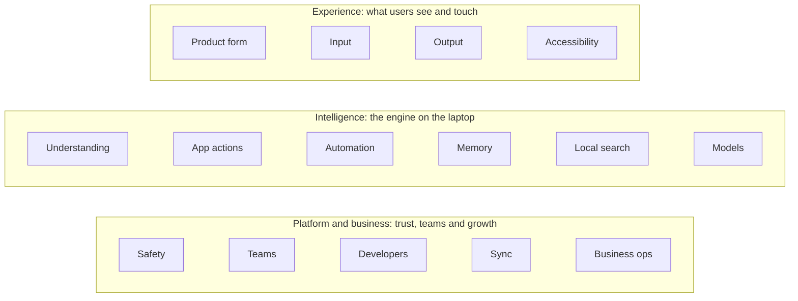

# Local Assistant Engine — 00 Full Product Map (End Goal)

6 Nov 2026 · @Ved Narvekar

## Summary

This is the full menu: everything the finished product should have, not just v1. It splits the product into 15 areas. Each area will get its own detailed doc next.

Every item has a version tag:

- **v1:** in the first launch (matches docs 02–11).
- **v2:** the next big release, roughly 6–12 months after launch.
- **Later:** planned, but timing depends on users and growth.

The tags are a starting proposal. They change as users give feedback.

**Guiding principle: plan the full plate.**

- The product's end goal is an assistant that can work with a very large and growing set of apps, tools and skills.
- WhatsApp, Spotify and the other v1 apps are only the first examples, chosen to prove the engine works.
- Version tags (v1, v2, Later) show the order things get built, not limits on what the product will do.
- Every design decision must work at end-goal scale, even when v1 uses only a small part of it.

## Product map

**The full product has 15 areas in three layers**

The middle layer is the core of the product: the engine that runs on the laptop. The sections below take each area in turn.

## Product form

It is a desktop app, not a website. It installs like any app, runs quietly in the background, and opens with a hotkey. It has to live on the computer, because it controls apps and files there and runs the AI locally. Every other form below connects to this desktop app.

| Form | What it is | When |
|---|---|---|
| Windows desktop app | Background service plus the command bar | v1 |
| Mac desktop app | Same engine, with a macOS adapter | v2 |
| Linux desktop app | For developers and power users | Later |
| Browser extension | Better control of web apps, like Gmail in Chrome | v2 |
| Command line and local API | Developers can script the assistant | v2 |
| Phone companion app | Send a request to your laptop from your phone; get reminders | Later |

## Input

| Capability | What it means | When |
|---|---|---|
| Typed requests | Type in the command bar after pressing the hotkey | v1 |
| Context awareness | Knows the selected file and open app | v1 |
| Selected text as context | Highlight text anywhere, then ask, like "reply to this" | v2 |
| Push-to-talk voice | Hold a key and speak; speech is turned into text on the device | v2 |
| Wake word | Say "Hey [name]" hands-free; listening happens on the device, opt-in only | Later |
| Right-click menu | Right-click a file or text and choose "Ask the assistant" | v2 |
| Drag and drop | Drop a file onto the bar, then say what to do with it | v2 |
| Point at the screen | Select a part of the screen as input | Later |

Voice needs two more small models on the device: speech-to-text and, for spoken replies, text-to-speech. Both have good open-source options.

## Output and feedback

| Capability | What it means |
|---|---|
| Result line, confirm cards, Undo, progress list | The core screens from doc 09 |
| Windows notifications | Reminders, timers, finished tasks |
| Morning brief | Urgent emails and today's meetings in one view |
| Spoken replies | The assistant answers out loud, on the device |
| Richer daily view | A small panel with today's schedule, follow-ups and suggestions |
| On-screen highlights | Shows where it clicked, so users can follow along |

<!-- Note: the "When" column of this table was cut off at the right edge of the screen in the photos, so its values are not visible. -->

## Understanding engine

| Capability | What it means | When |
|---|---|---|
| Task routing | Picks the right task from casual wording | v1 |
| Detail extraction | Pulls out contacts, files, times, places | v1 |
| Resolver | Turns "this" or "Ved" into exact items | v1 |
| Planner | Combines skills for chained requests | v1 |
| Clarifying questions | Asks one short question when unsure | v1 |
| Follow-up conversation | Remembers the last few requests, so "send it to Priya too" works | v2 |
| Mixed-language requests | Understands mixes like Hindi and English in one sentence | Later |
| More languages | Full support for Hindi, Spanish and others | Later |

## Actions and app coverage

| App group | Examples | When |
|---|---|---|
| System controls | Volume, Wi-Fi, Bluetooth, Do Not Disturb, screenshots | v1 |
| Files and cloud drives | Local files, OneDrive, Google Drive | v1 |
| Email and calendar | Gmail, Outlook, Google Calendar, Outlook Calendar | v1 |
| Messaging | WhatsApp, Teams | v1 |
| More messaging | Slack, Telegram, Discord | v2 |
| Media | Spotify, YouTube | v1 |
| Office documents | Create and edit Word, Excel, Google Docs and Sheets, like "add this row" | v2 |
| Meetings | Join or schedule Zoom and Meet calls | v2 |
| Notes and tasks | Notion, Todoist, Microsoft To Do | v2 |
| Browser actions | Fill forms and click through websites | Later |
| Developer tools | Git, VS Code, terminal | Later |
| Screen understanding fallback | A vision model for apps with no API or accessibility support | Later |

## Automation

| Capability | What it means | When |
|---|---|---|
| Saved shortcuts | One command runs several steps, like "Friday report" | v2 |
| Scheduled tasks | Runs at a set time, like "every Friday at 5pm, send the report" | v2 |
| Routine detection | Notices repeated habits and offers to make a shortcut | v2 |
| Triggers | Runs when something happens, like "when my boss emails, notify me" | Later |
| Proactive suggestions | Offers help at the right moment, like "Your 3pm starts in 10 minutes. Open the notes?" | Later |

Anything that sends or shares still needs a confirm, even when automated, unless the user turns that off for one specific shortcut.

## Memory and personalization

| Capability | What it means | When |
|---|---|---|
| Learned defaults | Usual contact, app and folder for common words | v1 |
| Privacy panel | View, edit and delete everything learned | v1 |
| Preferences | Tone for drafts, preferred apps, working hours | v2 |
| People map | Who is who, and how the user usually reaches each person | v2 |
| Federated learning | Shared models improve across users without collecting data | Later |

## Local search and knowledge

| Capability | What it means | When |
|---|---|---|
| File search by name and type | "Find the budget sheet from last week" | v1 |
| Search by meaning | "Find the doc about the Goa trip budget," across files, emails and notes, using an index built on the device | v2 |
| Ask about your documents | Summarize a PDF, or answer questions from your own files | v2 |
| Offline knowledge pack | Common facts answered without the web | Later |

The search index stays on the device, encrypted, like all other local data.

## Models and runtime

| Capability | What it means | When |
|---|---|---|
| Model scheduler | Loads models only when needed, under 2GB | v1 |
| Open-source models first | Fine-tune only where nothing off the shelf works | v1 |
| Signed model updates | Small, safe updates from the update server | v1 |
| Speech models | Speech-to-text and text-to-speech on the device | v2 |
| NPU and GPU use | Faster, cooler, using AI chips in newer laptops when present | v2 |
| Optional cloud model | For rare hard tasks, off by default, only if the user or admin turns it on | Later |

## Safety, privacy and trust

| Capability | What it means | When |
|---|---|---|
| Risk levels, confirms, Undo | Nothing reaches another person without a confirm | v1 |
| Trick-instruction defense | Text inside emails or pages can never start actions | v1 |
| Encrypted local data and action log | Everything stored on the device is encrypted and visible to the user | v1 |
| Outside security test | An independent security firm tests the app before launch | v1 |
| Per-app permissions | For example, "may read email but never send" | v2 |
| Compliance certificates | SOC 2 and ISO 27001, needed by larger companies | Later |

## Accessibility

An assistant that does clicks for you can change daily life for people with limited mobility or vision. That makes accessibility both a duty and a real market.

| Capability | What it means | When |
|---|---|---|
| Full keyboard control | Every action works without a mouse | v1 |
| High contrast and text size | Follows Windows display settings | v1 |
| Screen reader basics | Works with Narrator and NVDA for the main screens | v1 |
| Full screen reader support | Every screen and message is read out clearly | v2 |
| Voice-only use | Use the whole product by voice, with spoken replies | v2 |

## Teams and enterprise

| Capability | What it means | When |
|---|---|---|
| Team plan and shared billing | One bill for the whole team | v1 |
| Shared team skills | A team's shortcuts, like "weekly client report," shared across members | v2 |
| Admin console | Set policies, allowed apps and confirm rules for the team | v2 |
| Single sign-on | Log in with Google Workspace or Microsoft Entra | v2 |
| Mass deployment | IT installs it on many laptops at once, through tools like Intune | Later |
| Audit export | Admins export action logs for compliance, with clear employee consent | Later |

## Developer platform

Outside developers can grow app coverage far faster than one team can. This is a long-term moat.

| Capability | What it means | When |
|---|---|---|
| Public skill format | Documented skill files anyone can write | v2 |
| Plugin host (WASM) | Sandboxed plugins in any language; skills get only the access they declare (see [00.11](00.11%20Developer%20Platform.md)) | v2 |
| MCP tool servers | Each tool from the existing MCP ecosystem becomes a skill, under the same safety rules (see [00.11](00.11%20Developer%20Platform.md)) | v2 |
| Skill toolkit | Tools to write, test and package new skills locally | v2 |
| Connector toolkit | Lets developers add support for new apps | Later |
| Skill marketplace | Free and paid skills, reviewed and signed before listing | Later |
| Open-source engine core | Possible; decide before v2 (see doc 10) | Decision |

## Sync and multiple devices

| Capability | What it means | When |
|---|---|---|
| Settings and shortcuts sync | Same setup on a work and home laptop, end-to-end encrypted so we can't read it | v2 |
| Phone companion | Send requests to your laptop and get reminders on your phone | Later |
| Memory sync | Learned defaults follow you across devices, opt-in and encrypted | Later |

Sync must never break the privacy promise. The server only stores data it cannot decrypt.

## Business and operations

| Capability | What it means | When |
|---|---|---|
| Accounts and licensing | Free, Pro and Team plans checked by account ID only | v1 |
| Payments | Monthly and yearly billing | v1 |
| Auto-updates | App, models and skills update safely in the background | v1 |
| Opt-in usage stats | Anonymous counts of which tasks work or fail | v1 |
| Crash reports | Opt-in, with personal data removed | v1 |
| Help center and in-app help | Short guides and "what can you do?" inside the bar | v1 |
| Support desk | Email support with a simple ticket tool | v1 |
| Referral program | Free months for inviting friends | v2 |
| Partner program | Pre-install deals with laptop makers and resellers | Later |

## Design now, build later

Some v2 and later features are cheap to add only if v1 is designed for them. These shape v1 decisions now:

| Later feature | What v1 must do now |
|---|---|
| Voice input | The engine accepts text from any source, not only the command bar |
| … | … requests and results |
| Developer platform | The skill format and connector interface stay stable and versioned |
| Sync | Local data is encrypted with a key that could later be shared safely between a user's devices |
| Admin console | The policy engine reads rules from a file that an admin could later control |
| Optional cloud model | The planner talks to models through one interface, so another model can plug in |

<!-- Note: rows between "Voice input" and "Developer platform" were not visible in the photos (only the tail "… requests and results" of one row shows at the top of the later frame). -->

## Order of detailed docs

Each area gets its own detailed doc, in this order. Areas that shape v1 design come first.

1. Product form and platforms
2. Input and voice
3. Understanding engine
4. Actions and app coverage
5. Models and runtime
6. Safety, privacy and trust
7. Memory, personalization and local search
8. Automation
9. Output and accessibility
10. Teams and enterprise
11. Developer platform
12. Sync and multiple devices
13. Business and operations

*Merged from: 00.A Addendum, guiding principle and A1/A5 (developer platform rows). Per-area detail lives in 00.1 to 00.13; this doc is the master list of what exists and when.*
