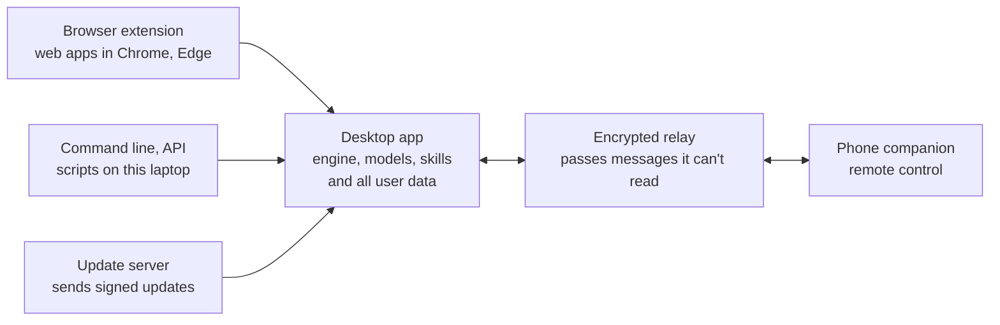

# Local Assistant Engine — 00.1 Product Form and Platforms

6 Nov 2026 · @Ved Narvekar

## Summary

The product is a desktop app. It must live on the computer because it controls apps and files there and runs the AI locally. Every other form, like the browser extension or phone app, is a companion that talks to the desktop app.

Version tags for each form (Windows v1; Mac, browser extension, command line v2; Linux, phone later) are in the [Product form table of the Full Product Map](00%20Full%20Product%20Map%20%28End%20Goal%29.md).

This doc details each form, the hardware it needs, and how it installs and updates.

## How the pieces connect

**Everything connects to the desktop app, which keeps all user data**



(Browser extension and Command line, API sit "on the same laptop" as the desktop app.)

The browser extension and command line talk to the desktop app directly on the same laptop. The phone reaches it only through a relay that can't read the messages. The update server only sends updates; it never receives user data.

## The desktop app

| Part | What it does | Visible to the user? |
|---|---|---|
| Background service | Runs the engine, listens for the hotkey, runs reminders | No; starts at login |
| Command bar | The text box, confirms, results, Undo | Yes, on hotkey |
| Tray icon | Pause, settings, quit, update status | Yes, always |
| Settings window | Hotkey, connected apps, privacy panel, plan | Yes, when opened |
| Model worker | Runs the models in a separate process | No |

**Behavior rules:**

- **Starts at login,** silently, and is ready in under 5 seconds.
- **One copy only.** Opening it again just shows the command bar.
- **Pause button** in the tray stops all listening and actions until resumed.
- **Quiet when idle:** under 1% CPU and under 300MB of memory.
- **Sleep friendly:** stops background work when the laptop is on battery saver, except reminders.

## Windows (v1)

| Topic | Decision | Why |
|---|---|---|
| Windows versions | Windows 11, plus Windows 10 (22H2) | Microsoft ended Wi… 2025, but many bud… Supporting it widens… |
| Chip type | Intel and AMD (x64) in v1; ARM laptops like Snapdragon in v2 | x64 is most laptops t… builds and testing |
| Install type | Per-user install, no admin rights needed | Many work laptops b… |
| Download | Direct from our website | Full control and fast… |
| Microsoft Store | Also list it there, if Store rules allow an app that controls other apps (to verify) | Trust and discovery |
| Code signing | Signed with a Windows code-signing certificate | Avoids "unknown pu… |

<!-- Note: the "Why" column was cut off at the right edge of the screen in the photos; "…" marks text that is not visible. -->

Windows 10 support gets reviewed each year. Drop it once its share among our users falls low.

## Hardware tiers

The app checks the laptop on first run and picks a mode. Users never need to know these tiers exist.

| Tier | Laptop | What works |
|---|---|---|
| Lite | Under 8GB RAM | Known tasks only. No planner, sur… drafts. A clear note explains why. |
| Standard (minimum) | 8GB RAM, 4-core CPU, SSD, no GPU | All v1 tasks. Planner loads on dem… |
| Plus | 16GB+ RAM | All tasks, with the planner kept lo… faster chained requests |
| AI PC | Laptop with an NPU or good GPU | Faster models and voice, using th… |

<!-- Note: the "What works" column was cut off at the right edge of the screen in the photos; "…" marks text that is not visible. -->

**Other needs for every tier:**

- SSD strongly recommended. On an old spinning hard drive, loading models can take much longer.
- About 4GB of free disk space for the app and models.
- Internet only for online apps, web lookups and updates.

## Mac (v2) and Linux (later)

### Mac (v2)

| Topic | Plan |
|---|---|
| Chips | Apple Silicon (M-series) first; their built-in AI chips make models fast |
| macOS versions | The latest three versions |
| Permissions | Users must grant Accessibility and Automation access once. Onboarding guides them step by step. |
| Search | Spotlight index for files |
| Distribution | Direct download, signed and notarized by Apple. The Mac App Store may not allow apps that control other apps (to verify). |
| What changes | Only the OS adapter. The core engine, skills and models stay the same. |

### Linux (later)

| Topic | Plan |
|---|---|
| Distros | Ubuntu and Fedora first |
| App control | AT-SPI accessibility interface |
| Known problem | Wayland, the newer Linux display system, limits global hotkeys and app control. Some features may only work fully on the older X11 system. |

## Browser extension (v2)

Many people use apps inside the browser, like Gmail or WhatsApp Web. The accessibility tree sees these poorly. A browser extension sees and controls web pages much more reliably.

| Topic | Plan |
|---|---|
| Browsers | Chrome and Edge first (same engine), Firefox later |
| How it talks to the app | Through the browser's built-in native messaging, directly to the desktop app on the same laptop |
| What it does | Reads the current page for context, and clicks or types on pages when a skill asks |
| Permissions | Asks per site; the user sees and controls which sites it may act on |
| Privacy | Page content goes only to the desktop app, never to our servers |
| Safety | Same rules: page text can never start an action, and sends still need a confirm |

## Command line and local API (v2)

For developers and power users who want to script the assistant or connect it to other tools, like Stream Deck buttons or launchers.

```
assistant run "send this week's report to my manager"
assistant run --confirm-in-app "post standup notes to the team chat"
assistant skills list
```

| Topic | Plan |
|---|---|
| Command line | A small program that sends requests to the desktop app |
| Local API | Works only on the same laptop, never over the network |
| Access control | Each script needs a token the user creates in settings and can revoke |
| Safety | Sends and shares still show the confirm card in the app by default |

## Phone companion (later)

The phone app is a remote control for the laptop, not a separate assistant at first.

| Topic | Plan |
|---|---|
| Pairing | Scan a QR code shown on the laptop |
| What it does | Send a request to your laptop, like "send the deck to Rahul," and approve confirms from your phone |
| Reminders | Get reminders and finished-task alerts on the phone |
| How it connects | Through a relay server that only passes end-to-end encrypted messages it cannot read |
| When the laptop is off | Requests wait and run when the laptop is back online, or the app says the laptop is offline |
| Platforms | Android and iPhone |

Running models on the phone itself is a possible later step, once phone hardware and our models allow it.

## Install, update and uninstall

| Step | How it works |
|---|---|
| Download | A small installer, around 50–100MB, so the download starts fast |
| First run | Models download in the background during onboarding. Known tasks work as soon as the small model lands; the planner arrives a few minutes later. |
| App updates | Download quietly, install on next restart. Release notes show in the tray. |
| Model and skill updates | Small signed packages; most are a few MB |
| Update channels | Stable for everyone; Beta for users who opt in early |
| Rollback | If an update fails its health check, the app returns to the previous version |
| Uninstall | Removes the app. Asks whether to also delete local data, like memory and the action log. |

The small-installer approach replaces the earlier "under 3GB download" target with a faster start. Total disk use stays about the same.

## Open decisions

- [ ] Confirm Windows 10 support in v1

<!-- Note: the photos end partway through the first open-decision item; any further items were not visible. -->
