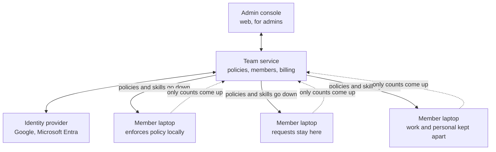

# Local Assistant Engine — 00.10 Teams and Enterprise

7 Nov 2026 · @Ved Narvekar

## Summary

Companies pay for tools that save their team time, and they need control: who can use what, which apps are allowed, and proof that company data is safe. This doc plans everything from a 3-person startup to a company with thousands of laptops.

The line we never cross: admins control what the assistant *may do*. They never see what employees ask, their messages, files or habits. All of that stays on each employee's laptop.

This doc covers the architecture, plans by company size, the organization model, the admin console, policies, single sign-on, deployment at scale, shared skills, usage insights, compliance, security, billing, support, building and testing.

## How it fits together

**Admins set rules centrally; each laptop enforces them locally**



Our team service only stores the organization, its members, policies and billing. Requests, messages and files never leave each member's laptop.

## Plans by company size

| | Team | Business | Enterprise |
|---|---|---|---|
| For | Startups and small teams, 2–20 people | Growing companies, 20–500 | Large companies, 500+ |
| Billing | Card, monthly or yearly | Card or invoice | Invoice, purchase orders, custom contract |
| Members and roles | Owner, admin, member | Plus groups and billing admins | Plus custom roles |
| Policies | Basic: allowed apps, confirm rules | Full policy set | Full set, per group |
| Sign-in | Email or Google/Microsoft sign-in | Single sign-on | Single sign-on plus automatic user management (SCIM) |
| Shared skills and recipes | Team library | Plus private skills | Plus approval workflows |
| Deployment | Each person installs | Silent install for IT | Mass deployment with Intune and similar tools; update rings |
| Usage insights | Basic counts | Full counts by group | Plus export |
| Compliance | Data processing agreement | Plus audit export | Plus data residency choice and security reviews |
| Support | Email | Priority email | Named contact and service-level agreement |
| When | v1 | v2 | Later |

Prices follow doc 10's Team plan for the first tier; Business and Enterprise prices are set later, from customer interviews.

## Organization model

### Roles

| Role | Can do |
|---|---|
| Owner | Everything, including deleting the organization and changing billing owner |
| Admin | Members, policies, shared skills, insights |
| Billing admin | Plans, seats, invoices; nothing else |
| Member | Uses the assistant under the organization's policies |

### Joining

- **Invite by email:** the member gets a link and signs in.
- **Domain join:** anyone signing in with a company email can join, if the admin allows it.
- **Single sign-on:** members are added from the company's identity system (see Identity).

### Groups (Business and up)

Groups, like "Sales" or "Finance," get their own policies and shared skills.

### Work and personal on one laptop

Many people use the same laptop for work and personal life. The assistant keeps them apart:

- **Work space:** work accounts (company Outlook, Teams), work skills and the organization's policies.
- **Personal space:** personal accounts (personal Gmail, WhatsApp, Spotify), personal memory, no organization policies.
- The organization never sees or controls the personal space.
- Requests are routed to the right space by the account and app involved; the user can switch spaces in one click.
- Admins can block personal space on company-owned laptops, if their policy requires it.

## The admin console

A web app for admins, signed in with two-factor or single sign-on. It never shows employee requests or content, because our servers never receive them.

| Section | What admins do there |
|---|---|
| Members | Invite, remove, assign roles and groups; see who has installed and is active |
| Policies | Set rules for the whole organization or per group (see Policies) |
| Apps and skills | Allow or block connectors, skills, MCP tools and capabilities |
| Shared library | Publish shared skills and recipes; approve requests to share |
| Insights | Privacy-safe usage counts (see Usage insights) |
| Security | Single sign-on, two-factor rules, signing keys for private skills |
| Compliance | Data processing agreement, audit export settings, data region |
| Billing | Plan, seats, invoices, payment method |
| Deployment | Installer download, setup keys, update rings |

## Policies

### What admins can set

| Category | Examples |
|---|---|
| Apps | Allow only Outlook and Teams for work; block personal WhatsApp in the work space |
| Skills and tools | Only Verified and private skills; no Community skills; no MCP tools |
| Capabilities | No sending outside the company domain; no file sharing links to external people |
| Confirms | Confirm every external send, even pre-approved automations |
| Automation | Allow schedules but not email triggers; cap sends per day |
| Data | Action log kept 30 days; search index off on shared laptops |
| Cloud features | Optional cloud model off; web lookups allowed or blocked |
| Personal space | Allowed or blocked on company laptops |

### How a policy reaches each laptop

Policies are bundled, signed by our server with the organization's key, and pulled by each app when it starts and every hour.

```yaml
org: acme-co
version: 41
signed_by: org-key-2026-01
rules:
  - block_capability: email.send:external
    except_groups: [sales]
  - require_confirm: sends:external
  - block_trust_level: community
  - action_log_days: 30
  - cloud_model: off
expires_offline_after_days: 14
```

### Rules for enforcement

- **Enforced on the laptop** by the same policy engine as every other rule.
- **Can only add safety:** an organization policy can never lower the product's own safety minimums, like confirms for sends.
- **Offline:** the last signed policy keeps working for a set time, then work features pause until the app checks in again.
- **Tamper check:** an edited or unsigned policy is rejected.

## Identity

| Feature | How it works | Plan |
|---|---|---|
| Sign in with Google or Microsoft | Standard OAuth sign-in for the organization account | Team |
| Single sign-on (SSO) | Through the company's identity system, like Microsoft Entra ID, Google Workspace, Okta, using the standard OIDC and SAML protocols | Business |
| Two-factor rules | Enforced by the company's identity system | Business |
| Automatic user management (SCIM) | The identity system adds and removes members automatically | Enterprise |
| Removing a member | On the next check-in, the app wipes work-space data and work tokens on that laptop, and revokes app sign-ins | All plans |

Signing in to the organization is separate from connecting apps. A member still connects their own work Outlook or Teams through the usual sign-in, and the organization's identity system can restrict that too.

## Deployment at scale

| Need | Plan |
|---|---|
| Silent install | An MSI installer with options for silent install and a pre-set organization ID, for tools like Microsoft Intune, Configuration Manager or Group Policy |
| Locked settings | IT can lock settings through Windows policy settings, like the hotkey or which apps are allowed |
| Update rings | Pilot group first, then everyone; IT can delay updates by a set number of days |
| Model downloads | Models can be pre-loaded in the installer, or served from a company file share, to save internet bandwidth on many laptops |
| Corporate proxies | Works through standard company proxies; honors system proxy settings |
| Firewall list | A published list of our domains for IT to allow |
| Security scanning | Signed files; a published software parts list (SBOM) for security teams |
| Mac (v2) | Deployment through Mac management tools, like Jamf or Intune for Mac |

## Shared and private skills and recipes

| Feature | How it works | Plan |
|---|---|---|
| Team library | Admins or members publish recipes like "weekly client report"; each member fills in their own details | Team |
| Private skills | The company's developers build skills for internal tools, like the company CRM or HR system, using the developer toolkit (doc 00.11) | Business |
| Org signing | Private skills are signed with the organization's own key; only that organization's laptops accept them | Business |
| Approval flow | New shared items need an admin's approval; anything that sends externally always does | Enterprise |
| Rollout | Publish to one group first, then everyone; roll back a version in one click | Business |
| Versions | Each item keeps its history; members get updates automatically | All |

## Usage insights for admins

Admins need to know the tool is worth paying for. They get counts, never content.

| Admins see | Admins never see |
|---|---|
| Seats used and active members this week | Anyone's requests, messages or files |
| Tasks run per category, like email or files | Which person ran which task |
| Success and failure rates per app | Learned habits or memory |
| Estimated time saved for the team | Search queries |
| Automations in use, by count | Recipients of any send |

**Privacy rules for the counts:**

- **Minimum group size:** no numbers are shown for any group smaller than 5 people, so nobody can be singled out.
- Counts come from the opt-in stats system (doc 00.6), sent as totals, not as individual events.
- Members can see exactly what their admin sees, in plain words.

## Compliance features

| Feature | What it is | Plan |
|---|---|---|
| Data processing agreement | A standard contract covering the small amount of data our servers hold | Team |
| Audit export | Exports action records (time, task type, app, result) without content, only where employees are told in advance and local law allows it | Business |
| Retention controls | Organization sets how long action logs are kept on laptops | Business |
| Data region | Choose where our server data is stored, like the EU or India | Enterprise |
| Security reviews | Answer security questionnaires; share penetration test summaries | Enterprise |
| Certificates | SOC 2, then ISO 27001 | Later |

**Legal holds and eDiscovery:** the assistant doesn't store copies of company email or files. Those stay in the company's own systems, like Microsoft 365 or Google Workspace, which already have legal hold and eDiscovery tools. This keeps us out of that scope.

## Security for organizations

| Protection | How |
|---|---|
| Signed policies | Policies are signed; edited or unsigned ones are rejected |
| Org signing keys | Each organization has its own key for private skills; we keep it in a hardware security service |
| Revoking access | Removing a member wipes work data at the next check-in and revokes their app sign-ins |
| Lost laptop | Admins mark it lost; work data is wiped when it next connects |
| Admin actions logged | Every admin change in the console is recorded and visible to other admins |

### Honest limits

On a laptop where the user has full admin rights, any local software, including ours, can in theory be bypassed by a determined user. So:

- The strongest controls are at the source: companies should also use their identity system's rules, like Microsoft Entra conditional access, to limit what any app can do with work email and files.
- For company-owned laptops, IT should use device management to lock settings and prevent tampering.
- We say this clearly in our admin documentation, rather than over-promising.

## Billing for teams

| Topic | Plan |
|---|---|
| Pricing unit | Per active seat, monthly or yearly (yearly at a discount) |
| Adding people | Seats added any time; charged for the rest of the period |
| Removing people | Seat freed at once; credit on the next bill |
| Payment | Card for Team; card or invoice for Business; invoice and purchase orders for Enterprise |
| Taxes | Correct tax per country, like GST in India and VAT in the EU, handled by the payment provider |
| Trials | Free first month for new teams (doc 10) |
| Invoices | Downloadable from the console, with company tax details |

## Support and service levels

| Plan | Support | Response target |
|---|---|---|
| Team | Email; help center; admin guides | Within 2 business days |
| Business | Priority email; onboarding call | Within 1 business day |
| Enterprise | Named contact; onboarding and rollout help; service-level agreement | Agreed in contract, like same day for urgent issues |

For all plans: a public status page for our servers, admin documentation, a security page, and release notes before each update reaches company laptops.

Because the assistant runs on each laptop, it keeps working even if our servers are down. Only sign-in checks, updates and the admin console depend on them.

## How we build it

### Server side (extends the update server in 06.1)

| Part | Tech | Plan |
|---|---|---|
| Team service: organizations, members, roles, groups, seats | Rust (Axum) + PostgreSQL | Team |
| Policy service: editing, versioning, signing bundles | Rust; signing keys in a hardware security service | Team (basic), Business (full) |
| Admin console | Web app (React + TypeScript) | Team |
| Single sign-on | Standard OIDC and SAML libraries | Business |
| SCIM endpoint | Standard SCIM 2.0 API | Enterprise |
| Insights pipeline | Aggregated counts with the minimum-group rule | Team |
| Billing | Payment provider's subscriptions and invoicing | Team |

### Desktop side

| Part | Job |
|---|---|
| Org client | Signs in to the organization; pulls signed policies and shared items |
| Policy enforcement | Adds org rules to the existing policy engine |
| Spaces | Keeps work and personal accounts, memory and rules apart |
| Remote wipe | Wipes work data on removal or a lost-laptop flag |
| MSI and Windows policy settings | Silent install and locked settings for IT |

### Build order

1. Team service, admin console basics, team billing, org client: the Team plan (v1).
2. Spaces and remote wipe.
3. Full policies, groups, single sign-on, MSI and update rings: the Business plan (v2).
4. SCIM, data regions, approval flows, audit export: Enterprise (later).

## How we test it

| Test | What it checks |
|---|---|
| Policy enforcement | Every policy rule blocks what it should, on real laptops |
| Safety floor | No organization policy can remove confirms for sends |
| Tampered policy | Edited or unsigned policies are rejected |
| Offline policy | Laptop offline past the limit pauses work features, then recovers |
| Spaces | Work rules never touch personal accounts; no data crosses between spaces |
| Single sign-on | Test organizations in Microsoft Entra, Google Workspace and Okta |
| Member removal | SCIM or manual removal wipes work data and revokes tokens at next check-in |
| Silent install | MSI on clean Windows machines, with Intune and Group Policy |
| Proxies | Works behind common company proxy setups |
| Insights privacy | No count shown for groups under 5; no individual data reaches the console |
| Load | Team service handles thousands of laptops checking in hourly |

## Open decisions

- [ ] Can organizations require usage counts from members, or must counts stay opt-in for each person?
- [ ] Business and Enterprise pricing, from customer interviews
- [ ] Which identity providers to certify first for single sign-on
- [ ] Data regions to offer first: EU, India, US?
- [ ] How long a laptop can stay offline before work features pause

Next doc: [00.11 Developer Platform](00.11%20Developer%20Platform.md).
