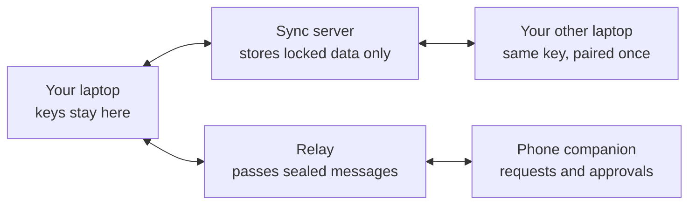

# Local Assistant Engine — 00.12 Sync and Multiple Devices

7 Nov 2026 · @Ved Narvekar

## Summary

Many people use two laptops, like work and home, and a phone. Sync gives them the same shortcuts, settings and learned habits everywhere. The phone companion lets them send requests to their laptop and approve confirms on the go.

The promise: sync is end-to-end encrypted. Data is locked on the user's device before it leaves, and only their own devices hold the key. Our servers store and pass along data they cannot read.

This doc covers how devices connect, what syncs, the encryption and keys, merging changes, adding and losing devices, the phone companion, moving to a new laptop, team rules, what our servers know, costs, building, testing and edge cases. Sync is v2; the phone companion is later.

## How devices connect

**Servers pass and store only locked data; keys stay on your devices**

Dashed boxes (the sync server and the relay) are our servers; they can't unlock anything they hold.

Laptops sync through the sync server; the phone talks to the laptop through the relay. Both servers only ever handle data that's already locked.

## What syncs and what never does

| Data | Syncs? | Why |
|---|---|---|
| Settings and preferences | Yes | Same experience everywhere |
| Shortcuts and recipes | Yes | Build once, use on any laptop |
| Facts the user asked to remember | Yes | Same memory everywhere |
| Learned defaults and personal phrases | Yes, opt-in | Useful, but some users want each laptop separate |
| People map | Yes, opt-in | Same as above |
| Installed skills list | Yes | Each device downloads the skills itself |
| Action log | No by default; opt-in later | Large, and most useful on the device where things happened |
| Search index | Never | Rebuilt on each device from its own files |
| App sign-in tokens | Never | Each device signs in to apps itself; safer if one device is lost |
| Models | Never | Downloaded on each device |
| Audio, context, screen | Never | Never stored anywhere |

Users turn sync on per category in settings.

## End-to-end encryption

### The keys

| Key | What it is | Where it lives |
|---|---|---|
| Sync key | A random secret that locks and unlocks all synced data | Only on the user's devices, protected by Windows (DPAPI and the TPM chip when present) |
| Device keys | Each device's own key pair, used to pass the sync key safely to a new device | On that device only |
| Recovery key | A printable code that can rebuild the sync key | Wherever the user keeps it: paper, a password manager |

Our servers never see the sync key or the recovery key.

### How data is locked

- Each change is encrypted on the device with a modern, well-reviewed method (XChaCha20-Poly1305), and signed so tampering shows.
- Only the locked bytes, a size and a time go to the sync server.
- We use established, audited libraries (like libsodium-style Rust crates), never our own cryptography.

### If every device is lost

- **With the recovery key:** the user enters it on a new laptop, and all synced data comes back.
- **Without it:** the synced data can't be recovered, by anyone, including us. This is the honest price of end-to-end encryption. Setup explains it clearly and asks the user to save the recovery key.

## The sync engine

### Offline first

Each device works fully on its own. Changes are saved locally first, then sent when online. Devices catch up whenever they reconnect.

### Merging changes without conflicts

The server can't read data, so it can't merge it. Devices must merge changes themselves. We use simple, proven merge rules per data type, based on conflict-free replicated data types (CRDTs), a standard technique for this:

| Data type | Merge rule | Example |
|---|---|---|
| A setting | Latest change wins, per setting | Hotkey changed on both laptops: the most recent change stays |
| Learned scores | Changes add up | Using "Ved" on both laptops counts on both |
| Facts, shortcuts, skills list | Add and remove items; a deletion wins over an older edit | A fact deleted on one laptop disappears everywhere |
| A recipe | Latest whole version wins; older versions kept in history | Edited on two laptops: newest stays, the other is recoverable |

If a full CRDT library is needed later, Rust options like Automerge exist; v2 starts with these simpler rules.

### When it runs

A few seconds after a change, on app start, and every few minutes while online. Pauses on battery saver and metered connections. Each change is tiny, usually a few KB.

## Adding, removing and losing devices

### Adding a device

1. Install the app on the new laptop and sign in to the same account.
2. The new laptop shows a QR code or a short code.
3. On an existing laptop, the user scans or types it and approves: "Add 'Home laptop'?"
4. The existing laptop passes the sync key to the new one, encrypted for that device only.
5. Synced data downloads and unlocks on the new laptop.

No existing device nearby? Enter the recovery key instead.

### Removing a device

In the device list, choose Remove. The removed device is cut off from new data: the remaining devices create a new sync key and re-lock everything with it.

### Losing a device

Mark it lost from any other device or the account page. It's removed as above, and if it ever comes online again, it wipes its synced data. Its local encryption still protects anything on it while it's offline.

## Phone companion (later)

### What it does

| Feature | Example |
|---|---|
| Send a request to the laptop | On the way to a meeting: "send the deck to Rahul" |
| Approve confirms | The laptop asks; the phone shows the same confirm card with recipient and content |
| Reminders and alerts | Reminders, automation alerts and failures arrive on the phone |
| Status | See whether the laptop is online, and what ran today |

The phone doesn't run the AI or store memory at first. The laptop does the work.

### How it connects

1. **Pairing:** scan a QR code on the laptop. The phone and laptop exchange keys directly.
2. **Relay:** messages travel through our relay server, end-to-end encrypted with an established secure-channel protocol (like the Noise framework). The relay can't read them.
3. **Waking the phone:** Apple and Google push services send only a content-free "new message" signal. The real message is fetched and unlocked on the phone.
4. **Laptop offline:** the request waits on the relay, still locked, until the laptop is back, or the phone says the laptop is offline.

### Built with

A shared Rust core for encryption and message handling, used from native Android (Kotlin) and iPhone (Swift) apps through Mozilla's UniFFI binding tool. Or a cross-platform UI framework, decided later.

## Moving to a new laptop without sync

For users who never turn sync on, or don't want an account:

1. On the old laptop: Settings, then "Export my assistant." This creates one encrypted file with settings, shortcuts, facts and learned defaults, locked with a password the user picks.
2. Move the file by USB drive or any other way.
3. On the new laptop: "Import," choose the file, enter the password.
4. Sign in to apps again on the new laptop. Tokens are never exported.

This works fully offline and involves no server at all.

## Work and personal sync on teams

The work and personal spaces from doc 00.10 sync separately, with separate keys.

| Space | Synced between | Controlled by |
|---|---|---|
| Personal | The user's own devices | The user only; the organization never sees or controls it |
| Work | The user's work devices | The organization's policy: sync allowed, limited to company laptops, or off |

When a member leaves the organization, work-space data is wiped on all their devices at the next check-in. Their personal space is untouched.

Shared team skills and recipes don't use personal sync. They come from the team service (doc 00.10).

## What our servers know, and costs

### What the servers can see

| Server | Can see | Can't see |
|---|---|---|
| Sync server | The account, a list of device IDs, the size and time of each locked change | Any content: settings, shortcuts, facts, … |
| Relay | That a phone and laptop are exchanging messages, and their sizes and times | What the messages say |
| Push services (Apple, Google) | That a "new message" signal was sent | Anything else |

<!-- Note: the end of the "Can't see" cell for the sync server was cut off at the right edge of the screen in the photos. -->

Old locked changes are compacted regularly, so the server keeps only what's needed to bring a device up to date.

### Costs

- **Storage:** a few MB per user; very cheap.
- **Relay traffic:** small text messages; cheap.
- **Plans:** sync and the phone companion come with Pro and Team plans.

## How we build it

| Part | Tech | When |
|---|---|---|
| `crypto` | Audited Rust crates for encryption, signing and key exchange (XChaCha20-Poly1305, Ed25519, X25519) | v2 |
| `keystore` | Sync and device keys protected by Windows DPAPI and the TPM; recovery key creation | v2 |
| `sync_client` | Local change log, merge rules, upload and download, offline handling | v2 |
| Device pairing UI | QR and short-code pairing; device list; remove and lost | v2 |
| Export and import | Password-locked file of synced categories | v2 |
| Sync server | Rust (Axum); locked changes in object storage, metadata in PostgreSQL | v2 |
| Relay server | Rust, persistent connections (WebSockets); stores nothing but waiting locked messages | Later |
| Push service | Apple and Google push, sending content-free signals only | Later |
| Phone apps | Shared Rust core via UniFFI; native Android and iPhone apps | Later |

### Build order

1. Export and import (no server needed; useful from v1.x).
2. `crypto`, `keystore` and the recovery key.
3. Sync server and `sync_client` for settings and shortcuts.
4. Learned defaults, facts and the people map, with merge rules.
5. Device pairing, removal and lost-device flow.
6. Relay, push and phone apps.

Before launch, an outside security firm reviews the encryption design and code.

## How we test it

| Test | What it checks |
|---|---|
| Server can't read | Inspect everything stored on the sync server and relay; no readable content anywhere |
| Multi-device simulation | Three to five simulated devices editing the same data while going on and offline; all end up identical |
| Merge rules | Each data type merges as specified, including deletes and old devices reconnecting |
| Removed device | A removed device can't unlock any data created after removal |
| Recovery | Recovery key restores everything on a fresh laptop; a wrong key restores nothing |
| Pairing safety | Pairing can't be completed without approval on an existing device |
| Push content | Push signals carry no content |
| Export and import | Round trip restores every exported category; wrong password fails safely |
| Outside crypto review | Independent experts review the design and code before launch |
| Load | Sync server handles many devices syncing at once |

## Edge cases

| Case | How it's handled |
|---|---|
| Laptop clocks disagree | Changes are ordered by per-device counters, not wall-clock time alone |
| Same setting changed on two laptops while offline | Latest change wins; the other shows in history |
| Item deleted on one laptop, edited on another | Deletion wins, with a short-lived "restore" option |
| A laptop returns after months offline | Catches up from the compacted history; nothing lost |
| Recovery key lost, but one device still works | Create a new recovery key from that device |
| All devices and recovery key lost | Synced data is gone; local data on any found device is still encrypted |
| Phone lost | Remove it from any laptop; it can no longer send requests or approve confirms |
| Organization removes the member | Work-space data wiped on all devices; personal space untouched |
| Two accounts on one laptop | Each Windows account has its own keys and sync |

## Open decisions

- [ ] Sync learned defaults and the people map by default, or opt-in?
- [ ] Offer action log sync at all?
- [ ] Phone apps: native Kotlin and Swift, or a cross-platform framework?
- [ ] Ship export and import in a v1 update, before full sync?

Next doc: [00.13 Business and Operations](00.13%20Business%20and%20Operations.md).
