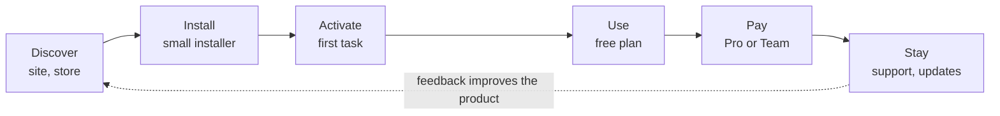

# Local Assistant Engine — 00.13 Business and Operations

7 Nov 2026 · @Ved Narvekar

## Summary

A great product still fails without the business machinery around it: accounts, payments, releases, support, analytics, servers and legal basics. This doc plans all of it, from beta to many thousands of users.

The local-first design changes the economics in our favor. AI runs on users' laptops, so there is no AI bill per request. The main running costs are downloads of models, a few small servers, web lookups and support.

This doc covers the customer lifecycle, accounts and licensing, payments, releases, analytics, reliability, support, docs, infrastructure and costs, legal basics, the team after launch, key metrics and how we build it.

## Customer lifecycle

**The first minute after install decides whether users stay**

Each stage has its own systems in this doc: the website and store, the installer and updates, onboarding, the free plan, payments, and support. Activation is where most products lose people, so it gets the most care.

## Accounts and licensing

| Topic | Plan |
|---|---|
| Free plan | Works without an account; the free limits are checked on the device |
| Paid plans | Need an account: email sign-in, or Google or Microsoft sign-in |
| License check | The server issues a signed license token. The app checks it on the device, so it works offline |
| Refresh | The token refreshes about weekly while online; a grace period of a few weeks covers long offline stretches |
| Devices per plan | Pro covers a few devices per person; Team is per seat |
| Lapsed payment | Falls back to the free plan; nothing is deleted |
| Piracy | Reasonable checks only; we never punish paying users with heavy copy protection |
| Account data on our servers | Email, plan, payment status and device count; nothing else (doc 00.6) |

## Payments and billing

| Topic | Plan |
|---|---|
| Provider | Stripe for global cards; Razorpay for India (UPI, Indian cards); both if selling in both markets |
| Currencies | INR and USD first; EUR later |
| Regional pricing | Lower prices in some countries, set by purchasing power |
| Taxes | GST, VAT and US sales tax calculated and collected through the provider |
| Billing periods | Monthly or yearly; yearly at a discount |
| Failed payments | Automatic retries and reminder emails, then fall back to free |
| Refunds | Simple refunds within a short window, no questions asked |
| Plan changes | Upgrade or downgrade any time; prorated |
| Discounts | Student and nonprofit discounts later |
| Lifetime license | Option to test, from doc 10 |

All payment card details stay with the payment provider. We never see or store card numbers.

## Releases and updates

| What updates | How often | How |
|---|---|---|
| The app | About monthly, plus urgent fixes | Signed installer; staged rollout; automatic rollback on failure spikes |
| Selector packs (app control fixes) | Whenever an app changes, often within hours | Small signed data files |
| Skills | Weekly or as needed | Small signed files |
| Models | About quarterly, after re-checks (doc 00.5) | Signed; staged; previous version kept |
| Kill-switch list | Immediately when needed | Signed list, checked often |

| Channel | Who | Purpose |
|---|---|---|
| Internal | The team | Daily builds for testing |
| Beta | Users who opt in | New features a few weeks early |
| Stable | Everyone | Tested releases |
| Team rings | Company IT | Pilot group first, then the company (doc 00.10) |

Every release has short, plain release notes, shown in the tray and on the website.

## Privacy-safe product analytics

We need to know what works to improve the product, without watching users.

| Rule | Detail |
|---|---|
| Opt-in | Asked once during onboarding, in plain words; can be changed any time |
| Counts only | Like "task F1: 12 successes, 1 failure today"; never request text, names, files or recipients |
| Batched daily | Sent once a day as totals, not as a stream of events |
| No tracking IDs across services | A random install ID only, reset if the user wants |
| Kept short | Raw daily totals kept about 90 days; only summaries after that |
| Self-hosted | Analytics run on our own servers, not shared with ad or analytics companies |

What we measure: installs, activation (first task within 60 seconds), daily and weekly active use, task success per skill and connector, crash-free sessions, feature use (voice, automations), and plan upgrades.

## Reliability operations

| Area | Plan |
|---|---|
| Crash reports | Opt-in, with personal data stripped; grouped by cause, so the biggest problems are fixed first |
| Connector health | A dashboard of success rates per app, from nightly tests and opt-in counts; alerts when an app update breaks something (doc 00.4) |
| Server targets | Update, license, sync and team services: 99.9% uptime target |
| Alerts | Automatic alerts for server errors, failed updates, connector breaks and crash spikes |
| On-call | A weekly rotation among engineers once the beta starts, with clear playbooks |
| Status page | Public, showing server health and known issues |
| Incidents | The response plan from doc 00.6: detect, contain, tell people, fix and learn |

A helpful side effect of local-first: when our servers have problems, the assistant keeps working on every laptop. Only sign-in checks, updates and sync wait.

## Customer support

| Topic | Plan |
|---|---|
| Channels | In-app "Get help," help center, email, community forum; priority email for Business; named contact for Enterprise |
| Tool | A standard helpdesk tool, like Help Scout, Freshdesk or Zendesk |
| Diagnostics | Users can choose to attach a diagnostics bundle: app and model versions, connector health and error codes. Never message text, names or files. Users see the bundle before sending |
| Response targets | Free: community and help center; Pro: 2 business days; Team and up: as in doc 00.10 |
| Playbooks | Ready answers for common issues: sign-in expired, WhatsApp not responding, hotkey clash, low memory |
| Escalation | Support tags issues; engineering gets a weekly list of top problems |
| Feedback loop | Feature requests and "the assistant couldn't do this" reports feed the skill and connector roadmap |

The best support is less support: clear error messages with a fix button (doc 09) prevent most tickets.

## Help center and docs

| Audience | Content | When |
|---|---|---|
| Users | Getting started, what it can do, connecting apps, privacy, fixing common problems, short videos | v1 |
| In the app | "What can you do?" answered by the assistant itself, with examples for the apps the user has | v1 |
| Team admins | Setup, policies, deployment, security and privacy details, firewall list | v1 basics, v2 full |
| Developers | Skill format, plugin guides, API reference, examples (doc 00.11) | v2 |
| Security teams | Security page, encryption overview, software parts list, how to report problems | v1 |

All docs follow the same writing rules as the app: short, plain, one idea per sentence.

## Infrastructure and running costs

### Servers we run

| Server | Job | When |
|---|---|---|
| Website and landing page | Marketing, downloads, account pages | v1 |
| Update and download service | Installers, models, skills, selector packs, kill-switch list | v1 |
| License service | Signed license tokens | v1 |
| Team service and admin console | Organizations, policies, billing (doc 00.10) | v1 basics |
| Web lookup proxy | Weather and search, scrubbed and cached | v1 |
| Analytics | Opt-in daily totals | v1 |
| Sync server | Locked sync data (doc 00.12) | v2 |
| Relay and push | Phone companion | Later |
| Marketplace | Listings, reviews, payouts (doc 00.11) | Later |

### The biggest cost to watch: model downloads

Each new install downloads about 2–3GB of models. With many installs, that adds up to a lot of data. Download fees from regular cloud storage could become the largest bill.

Plan: host models on storage with no download fees, like Cloudflare R2, behind a CDN. Ship model updates as small changes where possible, not full re-downloads.

### Other costs

| Cost | Grows with | Size |
|---|---|---|
| AI per request | Nothing; runs on laptops | Zero |
| Web lookups | Lookups per day | Capped per plan (doc 00.4) |
| Small servers and databases | Users, slowly | Low |
| Payment fees | Revenue | A few percent |
| Support tools | Paying users | Low to medium |
| Security tests, legal, certificates | Company stage | Fixed yearly costs |

## Legal and company basics

| Item | Why | When |
|---|---|---|
| Register the company | Contracts, payments, hiring, funding | Before the beta |
| Trademark the product name | Protect the brand once the name is chosen | Before public launch |
| Terms of use and privacy policy | Required by law and app stores | Before the beta |
| Data processing agreement | Needed by Team customers | Before Team launch |
| Open-source license compliance | Every library and model license honored; notices shown in About | Every release, automated |
| Code-signing certificate | Avoid Windows security warnings | Before the beta |
| Store and developer accounts | Microsoft Store, Apple, Google, Google API verification, Microsoft publisher verification | Before the features that need them |
| Insurance | Cyber liability and general business cover | Before public launch |
| Accounting and tax setup | Sales tax and income tax in each market | Before the first sale |

A lawyer should review the terms, privacy policy, app automation terms (doc 00.4) and developer agreement (doc 00.11).

## Team after launch

The build team from doc 08 grows with the product. Rough order of new roles:

| Role | Why | When |
|---|---|---|
| Support lead | Handle tickets; turn them into fixes and docs | Private beta |
| Marketing and community | Build in public, launch, creators, community | Before public launch |
| Operations engineer (SRE) | Servers, alerts, on-call, costs | Public launch |
| Security lead | Reviews, tests, incidents, certifications | Before the beta (doc 00.6) |
| More integration engineers | More apps and connector upkeep | After launch, as apps are added |
| Developer relations | Docs, examples, developer community | v2, with the developer platform |
| Sales for teams | Business and Enterprise customers | v2 |
| Partnerships | Laptop makers, app makers | Later |

## Key business metrics

One weekly dashboard, reviewed every Friday (doc 11).

| Area | Metric | Why it matters |
|---|---|---|
| Growth | New installs; waitlist; signups by channel | Is marketing working? |
| Activation | Share of installs that finish a task in 60 seconds | The first minute decides everything |
| Habit | Weekly active users; tasks per user per day | Is it part of daily life? |
| Retention | Day-7 and day-30 retention | Do people keep using it? |
| Quality | Task success rate; crash-free sessions; connector health | Does it work? |
| Revenue | Paying users; monthly recurring revenue; average revenue per user | Is it a business? |
| Conversion | Free to paid rate; trial to paid for teams | Are prices right? |
| Churn | Share of paying users who cancel each month | Are we keeping them? |
| Efficiency | Cost to acquire a customer; support tickets per 1,000 users | Is growth sustainable? |
| Costs | Download and lookup costs per active user | Are running costs under control? |

## How we build it

Most of this uses existing tools rather than custom code.

| Need | Build or buy | Choice |
|---|---|---|
| Website and landing page | Buy | A website builder at first; custom later |
| Accounts and licenses | Build | Rust (Axum) + PostgreSQL, on the update server stack (06.1) |
| Payments | Buy | Stripe and Razorpay |
| Downloads | Buy | Storage with no download fees, like Cloudflare R2, plus a CDN |
| Analytics | Build small, or self-host an open-source tool | Daily totals pipeline into a simple dashboard |
| Crash reports | Buy or self-host | Sentry, opt-in |
| Helpdesk | Buy | A standard helpdesk tool |
| Status page | Buy | A hosted status page service |
| Docs | Build | Static docs site |
| Monitoring and alerts | Buy or self-host | Standard server monitoring tools |

### Build order

1. **Before beta:** company, website, waitlist, terms, privacy policy, licenses, downloads, crash reports, helpdesk.
2. **Before public launch:** payments, analytics, status page, help center, on-call, trademark.
3. **After launch:** team billing, admin docs, marketplace payments, partner programs.

## Open decisions

- [ ] Main market and currencies at launch: India, global, or both?
- [ ] Devices allowed per Pro account
- [ ] License grace period when offline
- [ ] Self-host analytics or build a small pipeline
- [ ] Where to register the company

## What comes after the docs

This is the last area doc. Planning is complete. Next:

1. ~~Merge the addendum (00.A) into the main docs.~~ Done: merged into 00, 00.3, 00.4, 00.5, 00.11, 02, 03, 06, 6.1, 07, 10 and 11 (see the docs README).
2. Decision log: gather every open decision from all docs in one place, and close them (started in [8.1](../03-delivery/8.1%20-%20Decision%20Log.md), which covers docs 1–7).
3. Start real work from doc 11: user interviews, the landing page and waitlist, and the spikes.
