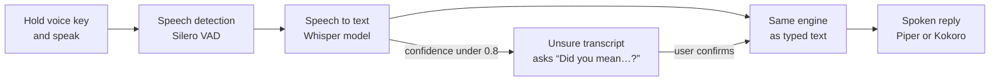
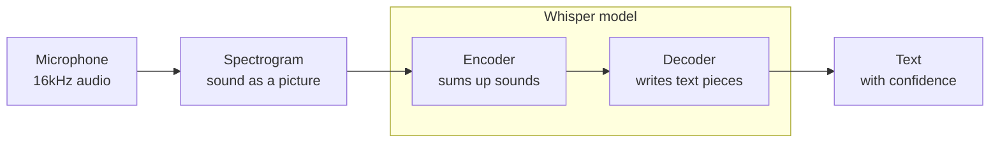

# Local Assistant Engine — 00.2 Input and Voice

6 Nov 2026 · @Ved Narvekar

## Summary

This doc covers every way a user can give the assistant a request, now and later.

Version tags for each input (typed and file/app context v1; selected text, push-to-talk voice with spoken replies, right-click and drag and drop v2; wake word and pointing later) are in the [Input table of the Full Product Map](00%20Full%20Product%20Map%20%28End%20Goal%29.md).

The key design rule: every input becomes the same kind of request inside the engine. Adding voice or a phone app later then needs no change to the engine.

## One input format

Typed text, voice, the command line and the phone all produce the same request event. The engine never needs to know where a request came from, except for a few safety rules.

```json
{
  "text": "send this file to ved on whatsapp",
  "source": "voice",             // typed | voice | cli | phone | right_click
  "confidence": 0.91,            // speech-to-text certainty; 1.0 for typed
  "context": {
    "selected_file": "C:/Users/.../Q3_report.pdf",
    "active_app": "File Explorer",
    "selected_text": null
  },
  "at": "2026-11-06T10:42:00"
}
```

**Rules by source:**

- **Voice with low confidence (under 0.8):** show the transcript first and ask "Did you mean…?"
- **Command line and phone:** sends still show the confirm card in the desktop app or phone.
- **Right-click:** the clicked file or text is always the context.

## Typed input

| Feature | How it works | When |
|---|---|---|
| Hotkey | Opens the quick bar from anywhere, in under 100ms | v1 |
| Plain language | No commands to learn; just type what you want | v1 |
| Suggestions as you type | Shows likely tasks after a few letters, like "send…" → recent contacts | v1 |
| History | Up arrow brings back earlier requests | v1 |
| Paste | Paste text or a file path straight into the bar | v1 |
| Empty-bar tips | When the bar opens empty, show 3 useful examples based on time of day | v1 |
| Typo tolerance | "spotfy" still means Spotify | v1 |

## Context capture

Context is what lets users say "this" instead of a full file path. It is captured only at the moment the hotkey is pressed, never continuously.

| Context | How it's read | When |
|---|---|---|
| Selected file or folder | File Explorer, through Windows Shell interfaces | v1 |
| Active app and window title | Windows foreground window | v1 |
| Open email or chat | The app's accessibility tree, or its API | v1 for emai… |
| Selected text | UI Automation text selection; clipboard as fallback, restored afterward | v2 |
| Current web page | Browser extension | v2 |

Context is used for that one request and then discarded. Only the result goes into the action log.

### How we build typed input and context

| Piece | How we build it |
|---|---|
| Global hotkey | Windows `RegisterHotKey` through the `windows` Rust crate. Setup warns if another app already uses the key. |
| Quick bar window | A Tauri window kept loaded but hidden, so it appears in under 100ms. Always on top, on the screen the user is working on. |
| Suggestions as you type | An in-memory fuzzy search over skill example phrases, recent requests and contacts. No model needed, so it's instant. |
| Typo tolerance | Fuzzy matching first; the embedding model handles the rest |
| Selected file in File Explorer | Windows Shell interfaces (COM) that list the selected items in the open Explorer window. More reliable than reading the screen. |
| Active app | The Windows foreground window and its program name |
| Open email | The app's accessibility tree gives the subject; the Gmail or Graph API fetches the full email |
| Selected text (v2) | UI Automation reads the selection. Fallback: copy it with Ctrl + C, read the clipboard, then put back what was there before. |

## Voice pipeline

**Voice becomes text first, then runs through the same engine**



Voice adds only three small models. Everything after speech-to-text is the same engine typed requests use, including confirms for sends.

## Push-to-talk voice (v2)

How it feels: hold the voice key, speak, let go. The words appear in the bar as they're understood, and the task runs.

| Part | Open-source option | Notes |
|---|---|---|
| Speech detection | Silero VAD | Tiny; trims silence so less audio is processed |
| Speech-to-text | Whisper models (tiny, base or small) via whisper.cpp | Runs on CPU; supports many languages, which helps Hindi later |
| Text-to-speech | Piper or Kokoro | Natural voices, light enough for an 8GB laptop |

Licenses and exact model sizes get checked in a voice spike, like the spikes in 05.

**Targets (to confirm in the spike):**

- Text appears under 1 second after the user stops speaking, for short commands.
- Voice models load when the voice key is first pressed, then stay loaded for a short idle time so follow-ups are instant.
- Peak memory stays within the 2GB budget.

**UX rules:**

- The spoken transcript always shows in the bar, so mistakes are visible.
- Sends still need a confirm. Saying "send" or pressing Enter confirms. The confirm is read aloud in voice-only mode.
- Spoken replies are short and optional. Users can keep replies as text only.

## How speech-to-text works

We don't build a speech model from scratch. We use an open-source one. Whisper, released by OpenAI, is the main candidate. It is a Transformer model trained on about 680,000 hours of speech in many languages.

**Whisper turns sound into a picture, then reads it as text**



**What happens inside, step by step:**

1. **Audio in.** The microphone audio is converted to 16kHz mono, a standard format for speech.
2. **Sound becomes a picture.** The audio is turned into a log-Mel spectrogram: a grid showing which sound frequencies are loud at each moment. This is how the model "sees" sound.
3. **Encoder listens.** The encoder, the first half of the model, reads the spectrogram and turns it into a compact summary of the sounds.
4. **Decoder writes.** The decoder, the second half, writes text one small piece (token) at a time, using the encoder's summary. It also predicts the language and when to stop.
5. **Text out.** The pieces join into the final sentence, with a confidence score for each piece.

One catch: Whisper was built to process audio in 30-second chunks. A 2-second command gets padded to 30 seconds, which wastes time. The fixes are below.

## Why it runs fast on a laptop

- **Small sizes exist.** Whisper comes in sizes from tiny (39M parameters) and base (74M) up to large (1.55B). Short commands don't need the large ones.
- **whisper.cpp.** A popular open-source C/C++ version of Whisper. No Python, small memory use, and it uses the CPU's fast math instructions (AVX2 on Intel and AMD).
- **Quantization.** Model numbers are stored in 4–8 bits instead of 16, cutting size and memory by half or more with little accuracy loss.
- **English-only versions.** For English, the smaller ".en" models are more accurate at the same size.
- **Shorter audio window.** whisper.cpp can be told to process less than 30 seconds, which speeds up short commands a lot.

## Models we will compare

A 2-week voice spike tests these on the 8GB laptop and picks one.

| Model | Why consider it | Watch out for |
|---|---|---|
| Whisper tiny.en or base.en (quantized), via whisper.cpp | Proven, widely used, good accuracy | 30-second window design; needs the shorte… window setting |
| Distil-Whisper | Faster versions of Whisper made by distillation | Mostly English; check sizes that fit |
| Moonshine | Built for speech on small devices; no 30-second padding, so short commands run fast | Newer; check accuracy on accents |
| Whisper small (quantized) | More accurate than tiny and base | Slower; may miss the 1-second target |

The winner is the one with the best accuracy on our commands that still meets the 1-second target and memory budget.

## How we build voice, step by step

All of this runs inside the desktop app, in Rust, except the models, which run in the model worker.

| Step | What it does | How we build it |
|---|---|---|
| 1. Capture | Records the microphone while the voice key is held | Windows audio (WASAPI) through the `cpal` Rust crate, into a short memory buffer. Nothing is written to disk. |
| 2. Convert | Changes audio to 16kHz mono | A resampling crate like `rubato` |
| 3. Detect speech | Finds where speech starts and stops; trims silence | Silero VAD, a tiny model run every 30ms of audio |
| 4. Live preview | Shows words in the bar while the user speaks | Runs speech-to-text on the audio so far, about every half second |
| 5. Final text | Produces the final transcript when the key is released | One last full pass for the best accuracy |
| 6. Clean up | Fixes numbers and names, like "ten minute" to "10-minute" | Simple rules, plus fuzzy matching against contacts and app names |
| 7. Confidence | Decides whether to ask "Did you mean…?" | Average certainty of the written pieces; under 0.8 asks first |
| 8. Hand off | Passes the text to the engine | The same request event typed input uses |
| 9. Spoken reply | Says the short result out loud, if turned on | Piper or Kokoro, run sentence by sentence so speech starts fast; played through `cpal` |

Model loading follows the scheduler rules in 07: voice models start loading the moment the voice key is pressed, then stay loaded for a few idle minutes.

## Getting names and commands right

General speech models often miss names like "Ved" or app names like "Todoist." Three tricks fix most of this without any training:

1. **Hint words.** Whisper accepts a short starting prompt. We fill it with the user's top contacts and app names, so the model expects them.
2. **Fuzzy fix-up.** After transcription, words that sound close to a known contact or app get corrected, like "wet" to "Ved" when the user is sending something.
3. **Show the transcript.** The user always sees what was heard, and the confirm card catches anything wrong before a send.

If accuracy on Indian English or other accents is still low after this, a small fine-tune on spoken commands is the fallback.

## How we test voice

- **Command recordings:** 500 spoken requests from the 04 test set, recorded by 20+ people with different accents, including Indian English.
- **Noise:** the same commands with background noise: fan, café, music, a second voice.
- **Measures:** word error rate on commands, name accuracy, time to text, and memory.
- **Targets:** under 10% word error rate on commands, 95%+ correct contact names, text in under 1 second.

## Wake word (later)

Saying "Hey [name]" starts listening without touching the keyboard.

| Topic | Plan |
|---|---|
| Model | A tiny always-on keyword model, like openWakeWord, running on the device |
| Opt-in | Off by default; turned on only in settings |
| Audio | Never saved and never sent anywhere. Only the wake word triggers full listening. |
| Indicator | The tray icon changes while listening, so users always know |
| Cost | Must stay under about 1–2% CPU when idle, or it isn't shipped |
| False triggers | Tested with TV, music and meetings in the background |
| Name choice | The product name must work as a wake word: short, clear, unlike common words |

## Right-click, drag and drop, and pointing

| Input | How it works | When |
|---|---|---|
| Right-click menu | "Ask the assistant" on files in File Explorer. Opens the bar with the file as context. The Windows 11 menu may need the app to be registered with an app identity (to verify). | v2 |
| Drag and drop | Drop files onto the open bar, then type or say what to do | v2 |
| Pointing at the screen | Draw a box around part of the screen. Text inside is read on the device (OCR), or a small vision model describes it. | Later |

Pointing is the only input that reads the screen. It runs only when the user draws the box, and the image is deleted right after.

## Privacy rules for input

These rules apply to every input type, now and later.

1. The microphone is used only while the voice key is held, or when the wake word is turned on by the user.
2. Audio is never saved and never leaves the device. Only the text transcript is kept, in the action log.
3. Context is read only at the hotkey press, for that one request, then discarded.
4. The screen is never read unless the user draws a box to point at something.
5. A visible indicator shows whenever the assistant is listening or reading context.
6. Users can turn off any input type in settings: voice, context, right-click or wake word.

## Open decisions

- [ ] Run a voice spike: which Whisper size meets the 1-second target on an 8GB laptop?
- [ ] Pick the push-to-talk key; it must not clash with common shortcuts
- [ ] Choose a default spoken voice, and whether to offer a few options
- [ ] Check licenses of all voice models for commercial use

Next doc: [00.3 Understanding Engine](00.3%20Understanding%20Engine.md).
