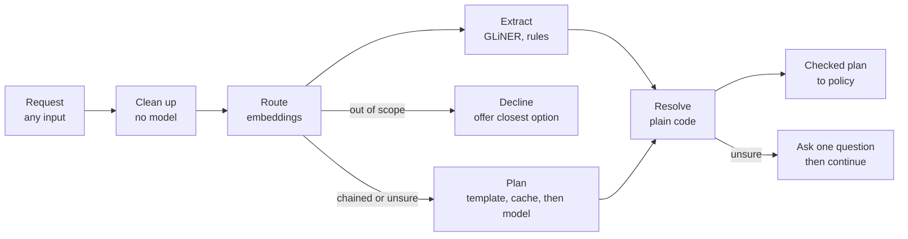

# Local Assistant Engine — 00.3 Understanding Engine

6 Nov 2026 · @Ved Narvekar

## Summary

The understanding engine turns a request like "send this to ved on whatsapp" into an exact, checked plan: which skill, which file, which contact. It does this in five stages:

1. **Clean up:** fix spelling, read times and numbers.
2. **Route:** pick the task.
3. **Extract:** pull out names, files, times and message text.
4. **Resolve:** match those words to real contacts, files and apps.
5. **Plan:** combine skills, only for chained or new requests.

Known tasks finish stages 1–4 in under about 150ms with small models and plain code. Only stage 5 uses the 1–3B model.

This doc covers what each stage does, how it works inside, which models and libraries it uses, how we build and test it, and the edge cases.

## Engine flow

**Known tasks go straight through; only unsure or chained ones plan**



Most requests take the top row only. The planner, the only stage that uses the 1–3B model, runs just for chained or unsure requests.

## Stage 1: Clean up

Plain code, no model. It makes the text easier for later stages.

| Step | Example | How |
|---|---|---|
| Trim and lowercase for matching | " Send THIS to Ved " → "send this to ved" | String rules; the original text is kept for message bodies |
| Fix common typos | "spotfy" → "spotify" | Fuzzy match against a list of app names and common words |
| Expand short forms | "tmrw" → "tomorrow", "pls" → "please" | A small dictionary of chat-style short forms |
| Read times and dates | "tomorrow 6pm", "in 10 mins", "next friday" | A date and time parser, tested on Indian and … formats |
| Read numbers | "ten minute timer" → 10 minutes; "18%" | Number word rules |
| Spot quoted text | "tell Ved 'running late'" | Text inside quotes is marked as message con… never as a command |

The parsed times and numbers are attached to the request, so later stages don't parse them again.

## Stage 2: Route

Goal: pick which of the 49 tasks the user wants, or decide it's out of scope.

**How it works**

1. **Exact rules first.** One-word commands like "pause", "louder" or "lock" match a fixed list instantly.
2. **Turn the request into numbers.** An embedding model turns the sentence into a vector: a list of 384 numbers that captures its meaning. Sentences with similar meaning get similar vectors.
3. **Compare with examples.** Each skill file holds 20–50 example phrases. Their vectors are computed once, when the skill is installed, and kept in memory.
4. **Find the closest examples.** The engine measures similarity (cosine similarity) between the request and every example, and takes the 10 closest.
5. **Vote.** Each close example votes for its skill, weighted by similarity. The result is a score per task.
6. **Out of scope.** A special "out of scope" group holds examples like "book an Uber" or "post on Instagram." If those win, or nothing scores high, the request is declined.
7. **Chained check.** Words like "and" or "then" split the request into parts. If two parts each match a different skill well, it goes to the planner.

**Why it's fast and small**

- The model is tiny: candidates are all-MiniLM-L6-v2 (22M parameters) or bge-small (33M), both making 384-number vectors.
- One request takes a few milliseconds on a laptop CPU.
- 49 skills × 50 examples × 384 numbers is under 4MB in memory.

**Routing at scale (thousands of skills)**

With 49 skills, comparing a request to every example is instant. With thousands of skills from many developers (see [00.11](00.11%20Developer%20Platform.md)), the engine needs a few more pieces. The planner still sees only the top 5 skills for each request, whatever the total count.

| Problem at scale | Solution |
|---|---|
| Too many examples to compare one by one | A vector index (like HNSW) finds the closest examples in milliseconds, even among hundreds of thousands |
| Similar skills confuse routing | Two-step routing: first pick a category (messaging, files, finance), then the skill inside it |
| Users only need some skills | Users install only the skills they use; the router searches installed skills first, then suggests others |
| Skill files take disk space | Skill packs download on first use, like streaming a game map |
| Two skills claim the same request | Prefer the user's installed and most-used skill; if still unclear, ask which one |
| Untrusted developers | Trust levels: Verified (reviewed by us), Community (sandboxed, extra warnings), Private (a team's own skills); see [00.6](00.6%20Safety%2C%20Privacy%20and%20Trust.md) |
| Skills break after updates | Each skill has a version and a minimum app version; broken versions can be pulled remotely |
| Planner sees too many tools | Only the top 5 skills go to the planner |

Design now: the v1 router stores skill vectors in a format that a vector index can use later, and every skill already has a `category` field (see [07 LLD](../02-design/7%20-%20Low-Level%20Design.md)).

**If accuracy is too low**

We fine-tune with SetFit, a method that adapts a small embedding model using only a few examples per class. It trains in minutes on a cheap rented GPU, or even on a laptop. No new hardware needed.

## Stage 3: Extract

Goal: find the details the chosen skill needs. The skill file lists its slots, like `file` and `contact`, so the extractor knows what to look for.

**Two tools, used together** (start with rules alone: test rules-only extraction in spike SP2 first, and add GLiNER only where rules fail, since rules may cover most v1 slots)

1. **GLiNER, a zero-shot extractor.** You give it the request and a list of labels, like "contact", "file", "app", "song". It marks which words match each label. "Zero-shot" means it works for new labels without training. It is an open-source encoder model, small enough for a CPU, with ONNX versions available.

```
Request: "send the budget sheet to rahul on whatsapp"
Labels:  contact, file, app
Output:  file = "the budget sheet"   contact = "rahul"   app = "whatsapp"
```

2. **Plain rules, for things rules do better than models:**

| Slot type | Rule | Example |
|---|---|---|
| Times and dates | Already parsed in stage 1 | "at 6pm" → 18:00 today |
| Durations and amounts | Number patterns | "for an hour", "18%" |
| Message text | Everything after the contact, or after "that" or "saying" | "tell Ved I'm on my way" |
| "This" and "it" | Marked as a reference to the context | Filled in stage 4 |
| On or off | Keyword list | "turn off Wi-Fi" |

**Why message text uses rules**

The message must be sent exactly as the user said it. A model might reword it. Rules copy it word for word, keeping the user's original capitals and punctuation.

## Stage 4: Resolve

Goal: turn words into exact things: "rahul" into one specific contact, "the budget sheet" into one file path. All plain code, no model except one fallback.

**Contacts**

Where the list comes from: Google and Microsoft contacts through their APIs, WhatsApp chat names read from the app, and recent email senders. Cached locally, encrypted, refreshed daily.

How a name is matched, in order, stopping at the first strong match:

1. **Learned nickname:** the user always picks Rahul Mehta for "rahul".
2. **Exact name match.**
3. **Sounds-alike match:** a phonetic algorithm (Double Metaphone) catches "ved" heard as "wed".
4. **Close spelling:** a string similarity score (Jaro-Winkler) catches small typos.
5. **App filter:** for WhatsApp, only WhatsApp contacts count.

For sends, only steps 1–2, or a confirmed choice, are allowed. Sounds-alike and spelling matches always ask first.

**Files**

1. **"This" or "it":** the selected file from context.
2. **Exact file name** in recent files.
3. **Windows Search query** for the words, filtered by type and date, like "sheet" → spreadsheets.
4. **Fallback:** the embedding model compares the description with file names and folder paths.

**Apps, times and others**

- **Apps:** matched against installed apps from the Start menu list.
- **Times:** already parsed in stage 1.
- **Playlists and songs:** passed to the Spotify connector's own search.

**When to ask**

If the top two matches score close together, the engine asks one question with up to three choices, as in doc 09.

## Stage 5: Plan

Used only for chained requests, or when routing isn't confident. It tries three things in order, cheapest first.

1. **Saved template.** If the request matches a known chain, like "find X and send it to Y," the engine fills a template. No model.
2. **Plan cache.** If a similar request was planned and worked before, that plan is reused with new details. No model.
3. **Local planner model.** Only if both miss.

**How the planner model works**

Model: an open-source 1–3B instruct model, 4-bit, in llama.cpp. Candidate families: Qwen, Gemma, Phi and Llama. License is checked per size, since some sizes in the same family have different terms.

What it's given, kept short so it stays fast:

- A few fixed rules: only use listed skills, at most 5 steps, never invent contacts or files.
- The top 5 skills from routing, each as a one-line signature, like `whatsapp.send_file(file, contact)`.
- The request and its context note.
- Values already found in stages 3–4.

How it answers: it drafts the plan freely first, then a grammar (GBNF in llama.cpp) shapes the draft into strict JSON. This avoids the accuracy drop small models show when forced into a format from the first word.

Checks before running, in plain code: every skill exists, every required slot is filled or linked to an earlier step, 5 steps or fewer, and sends keep their confirm. Failing plans are rejected with "I can't do that yet."

Learning: every plan that runs successfully is added to the plan cache, so the same kind of request skips the model next time.

## When to act, ask or decline

One decision table pulls the stages together. Thresholds are starting values, tuned in spike SP1.

| Situation | Action |
|---|---|
| Exact rule match, like "pause" | Act |
| Top task 0.85+, all required slots resolved | Act (with confirm if it sends) |
| Top task 0.85+, a slot missing or ambiguous | Ask one question about that slot |
| Top task 0.50–0.85, or chained | Plan: template, cache, then planner |
| Top two tasks close together (under 0.10 apart) | Ask: "Did you mean A or B?" |
| Out-of-scope group wins, or nothing above 0.50 | Decline, and offer the closest thing it can do |
| Voice transcript under 0.8 confidence | Show transcript and confirm before anything else |

## Follow-up conversation (v2) and more languages (later)

### Follow-ups

So users can say "send it to Priya too" or "no, the other Rahul."

- **Short-term memory:** the engine keeps the last 5 requests, with their resolved contacts, files and results, for about 5 minutes.
- **References:** "it", "that file", "him" and "here" are matched to the most recent fitting item, using simple rules first.
- **"Too" and "also":** repeat the last action with the new detail swapped in.
- **Corrections:** "no, the other one" re-opens the last choice question.
- **Design now:** v1 already stores recent requests in this format, so v2 only adds the reference rules.

### More languages

| Need | Plan |
|---|---|
| Hindi and other languages | Swap to multilingual versions of the embedding and extraction models, and add example phrases per language |
| Mixed Hindi and English | Add mixed-language examples to each skill; multilingual embedding models handle these reasonably well |
| Voice | Whisper already supports many languages |
| Replies and UI text | Translated strings; the planner's prompts in each language |

## Learning new phrasings on the device

Every user talks differently. The engine adapts to each user without retraining any model, and without sending anything off the laptop.

How: when a request succeeds, or the user picks the right task after a question, their exact phrase is added as a personal example for that skill. Its vector is stored locally. Next time, routing finds it as a close example.

| Event | What gets stored |
|---|---|
| "blast some lofi" works for Spotify play | Personal example: "blast some lofi" → `spotify.play` |
| User picks Rahul Mehta after "which Rahul?" | Learned nickname: "rahul" → Rahul Mehta |
| User corrects a wrong task | The phrase moves to the right skill; the wrong match gets less weight |

Rules: personal examples stay encrypted on the device, show in the privacy panel, and can be deleted. At most a few hundred are kept, oldest and least used dropped first.

## Speed budget

Targets per stage on the 8GB test laptop. These are budgets to build against, not measured numbers yet. Spikes SP1–SP3 confirm them.

| Stage | Budget | Model used |
|---|---|---|
| 1. Clean up | Under 5ms | None |
| 2. Route | Under 30ms | Embedding model |
| 3. Extract | Under 80ms | GLiNER |
| 4. Resolve | Under 50ms; up to 300ms if Windows Search is needed | None, or embedding model as fallback |
| Known task total | Under about 150ms | |
| 5. Plan, from template or cache | Under 20ms | None |
| 5. Plan, with planner model | 2–5 seconds | 1–3B model |

The 0.5-second target in 03 Requirements leaves room for the connector to start the action after these stages.

## How we build it

### Modules (Rust, inside the core engine)

| Module | Job | Libraries and models |
|---|---|---|
| `normalize` | Stage 1 | Own rules; a date and time parser crate, extended with our own patterns |
| `router` | Stage 2 | Embedding model in llama.cpp or ONNX Runtime (decided in SP1); in-memory vector list with cosine similarity |
| `extract` | Stage 3 | GLiNER in ONNX Runtime; own rules for messages, durations, on/off |
| `resolve` | Stage 4 | `strsim` crate for spelling similarity; a phonetic matching crate; Windows Search through the `windows` crate |
| `plan` | Stage 5 | Templates and plan cache in SQLite; planner model in llama.cpp with GBNF grammars |
| `context` | Short-term memory and personal examples | SQLite with encryption |
| `decide` | The act, ask or decline table | Plain Rust |

### Offline tools (Python, team side)

- **Example generator:** a large model writes 50+ example phrases per skill, including slang and typos. People review them before they go into skill files.
- **SetFit trainer:** used only if routing misses its target.
- **Evaluation script:** runs the test sets below and reports accuracy per stage.

### Build order

1. `normalize` and `decide`: plain code, easy to test first.
2. `router` with exact rules, then embeddings. Measure on T01–T90.
3. `extract`, starting with rules, then GLiNER.
4. `resolve` for files and contacts.
5. `plan`: templates first, then cache, then the planner model.
6. `context`: personal examples in v1; follow-ups in v2.

## How we test it

Each stage is tested on its own, so a failure points straight to the stage that caused it.

| Test set | Size | Used for |
|---|---|---|
| Doc 04 test set | 100 requests | Release gate, end to end |
| Paraphrase set | About 1,000 requests: each task worded 20 ways, with slang and typos | Routing and extraction accuracy |
| Tricky set | About 200: negations, two contacts, near-miss tasks, out-of-scope look-alikes | Edge cases below |
| Resolution set | Fixed contacts and files from the 04 test setup | Contact and file matching |
| Chain set | About 100 multi-step requests | Planner and plan checks |

| Stage | Measure | Target |
|---|---|---|
| Route | Right task picked | 95%+ |
| Extract | Right words found for each slot | 95%+ |
| Resolve | Right contact or file chosen | 98%+, and 100% never-wrong for sends |
| Plan | Valid, correct plans | 90%+; invalid plans always caught |
| Decide | Asks when it should, never guesses on sends | 100% on sends |

The paraphrase and tricky sets are written by people and a large model offline, then reviewed. Real user wording from interviews and the beta is added over time.

## Edge cases

| Case | Example | How it's handled |
|---|---|---|
| Negation | "don't send it yet, just draft it" | Negation words checked before routing; "don't send" blocks send skills and routes to draft |
| Two recipients | "send this to Ved and Rahul" | Extractor returns two contacts; one confirm card lists both |
| Unclear app | "message the team" | Ask: WhatsApp or Teams? Then remember the answer |
| Unknown contact | "email Ananya", not in contacts | Say so; offer to type the email address |
| Time past midnight | "remind me at 1" at 11pm | Means 1am tomorrow, shown clearly in the result line |
| Pasted content | User pastes an email and types "reply yes" | Pasted text is treated as data, never as commands |
| Very long input | A 500-word paste | Only the first line is routed; the rest is content |
| Partly out of scope | "find the deck and post it on Instagram" | Do the supported part, then say the rest isn't supported |
| Repeated request | Same send twice within a minute | Ask: "You just sent this. Send again?" |
| Mixed wording | "ved ko file bhej do whatsapp pe" | v1: decline politely in English; later: supported with mixed-language examples |

## Open decisions

- [ ] Embedding model: all-MiniLM-L6-v2 or bge-small (SP1)
- [ ] Run the embedding model in llama.cpp or ONNX Runtime (SP1)
- [ ] GLiNER size and license (SP2)
- [ ] Planner model family and size, with license check (SP3)
- [ ] Final confidence thresholds (SP1)
- [ ] How many personal examples to keep per user

Next doc: [00.4 Actions and App Coverage](00.4%20Actions%20and%20App%20Coverage.md).

*Merged from: 00.A Addendum, item A4 (routing at scale) and part of A6 (rules-first extraction).*
