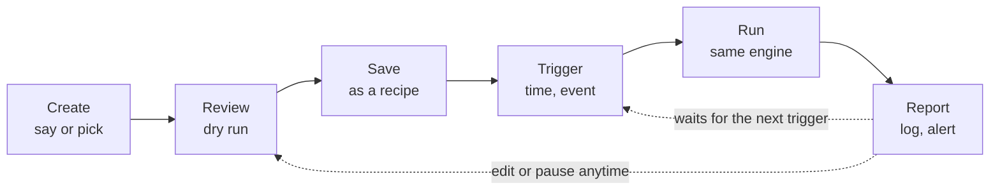

# Local Assistant Engine — 00.8 Automation

7 Nov 2026 · @Ved Narvekar

## Summary

Automation lets the assistant do things without being asked each time: "every Friday at 5pm, send this week's report to Priya," or "when my boss emails, notify me." This is where the biggest time savings are.

It is also where the biggest risks are, because no one is watching each run. So every automation is reviewed before it's turned on, runs through the same engine and safety rules as a typed request, and is always visible, editable and easy to stop.

This doc covers automation types, how they're stored and created, triggers, logic, safety rules, what happens when the laptop is off, history, sharing, how it fits the engine, building, testing and edge cases.

## Automation lifecycle

**Every automation is reviewed before it runs, and stays editable**



Nothing runs until it passes review with a dry run. After that, each run goes through the same engine and safety rules as a typed request.

## Types of automation

| Type | Example | Starts when | When |
|---|---|---|---|
| Saved shortcut | "Friday report" runs find, export and email in one command | The user types or says its name | v2 |
| Scheduled | "Every weekday at 9am, give me my morning brief" | A set time | v2 |
| Event-triggered | "When my boss emails, notify me"; "when a PDF lands in Downloads, move it to Bills" | Something happens in an app, a folder or the system | Later |
| Conditional | "If the invoice is over ₹10,000, ask me before saving" | Inside any automation | Later |
| Proactive suggestion | "Your 3pm starts in 10 minutes. Open the notes?" | The assistant notices a moment to help | Later |
| Team automation | A shared "weekly client report" each member runs with their own details | Shared by a teammate or admin | Later |
| Remote start | Start a shortcut on the laptop from the phone | The phone companion | Later |

## Recipe format

An automation is stored as a recipe: a small file that lists a trigger, steps and rules. Steps only use existing skills, so recipes never add new powers. Here is "Friday report."

```yaml
id: friday-report
name: Friday report
version: 2
trigger:
  schedule: "every friday 17:00"   # local time
  missed_run: "run_if_within 3h"   # see Laptop asleep or off
steps:
  - id: find
    skill: files.find
    slots: { query: "weekly report", folder: "Reports", newest: true }
  - id: send
    skill: email.send
    slots:
      to: "Priya Sharma <priya@company.com>"   # fixed recipient
      subject: "Weekly report"
      attach: "$find.file"
    confirm: pre_approved                      # see Safety rules
on_error: stop_and_notify
limits:
  max_runs_per_day: 1
  max_sends_per_run: 1
capabilities: [files.read:folder:Reports, email.send:fixed_recipients]
created_from: words        # words | suggestion | recording | template | shared
```

Recipes are stored in the encrypted local database, and are readable and editable by the user.

## Ways to create an automation

Every path ends at the same review screen before anything is turned on.

| Way | How it works | When |
|---|---|---|
| Say it in words | "Every Friday at 5, send the latest report to Priya." The planner turns it into a recipe; the time is parsed by plain code | v2 |
| Accept a suggestion | A detected routine (doc 00.7) becomes a recipe with one click | v2 |
| "Do what I just did" | Turns the last few actions in the action log into a recipe | v2 |
| Templates | A gallery of ready recipes, like "morning brief" or "save invoices to a folder" | v2 |
| Step editor | A simple list editor: add, reorder or remove steps; change details. A list, not a complex diagram | Later |
| Shared recipe | Import a recipe from a teammate or a link; its capabilities are shown before adding | Later |

### The review screen

- The recipe in plain words: "Every Friday at 5pm: find the newest file in Reports, then email it to Priya Sharma."
- What it can access, in plain words.
- A **dry run** button that shows exactly what would happen today, without doing it.
- Choices for confirms: ask each time, or pre-approve (only where allowed; see Safety rules).

## Triggers in detail

| Trigger | Examples | How it's detected locally |
|---|---|---|
| Time | Every Friday 5pm; weekdays 9am; the 1st of each month | The engine's own scheduler, in the local database; follows the laptop's time zone |
| Manual | Shortcut name, a hotkey, a right-click, the phone | Same as any request |
| New email | From a person, with a subject, with an attachment | Checks Gmail and Outlook for changes every few minutes, asking only for what changed since last time |
| Calendar | 10 minutes before a meeting | Reads today's events and sets timers |
| Files | New file in a folder; file changed | Windows file-change notifications |
| System | Login, joining a Wi-Fi network, plugging in a monitor, low battery | Windows system notifications |
| Chat messages | New message from a person | Harder: apps without APIs need the accessibility tree; may be limited |

**Why checking instead of instant alerts for email:** instant alerts from Google and Microsoft need a public server address to receive them. That would route data through our servers. Checking from the laptop every few minutes keeps everything local, at the cost of a short delay.

**Limits:** checking pauses on battery saver and when the laptop is asleep. Each account is checked at most once every few minutes.

## Conditions, loops and variables (later)

Kept simple on purpose. Anything more complex than this is better as two recipes.

| Feature | Example | Rules |
|---|---|---|
| Variables | `$find.file` passes the found file to the next step | Only from earlier steps or the trigger |
| Filters | "only if the sender is my boss"; "only PDFs" | Checked by plain code, not a model |
| If / else | "if the total is over ₹10,000, ask me; else save it" | Conditions use simple comparisons |
| For each | "for each attachment, save it to Finance" | Capped, like at most 20 items per run |
| Wait | "wait 10 minutes, then remind me" | Waits survive a restart; capped at a few days |
| Ask the user | "pause and ask before step 3" | Shows a notification with the choices |

Values from emails or messages, like an attachment's name, can fill slots in later steps. They can never change which steps run or add new recipients.

## Safety rules for automation

Automations follow every rule in doc 00.6, plus these, because no one watches each run.

### Confirms

- **Default:** any step that sends or shares asks for a confirm through a notification, every time.
- **Pre-approved sends** are allowed only when all of these are true:
  1. The recipients are fixed in the recipe, by exact address or number. Never taken from content.
  2. The recipients are people the user has sent to before.
  3. The content comes from a fixed template or a found file, not free text from content.
  4. The recipe has a daily cap, like 1 send per day.
  5. The user approved it on the review screen after a dry run.
- Every unattended send shows a notification afterward: "Friday report sent to Priya."

### Limits and stops

- Each recipe has caps on runs per day and sends per run.
- Auto-pause after 3 failures in a row, with a notification.
- Pause all with one click in the tray, or by saying "stop all automations."
- Loop guard: an automation can't trigger itself or another automation more than a few times in a row, so auto-replies can't bounce forever.

### Trick instructions

An email that triggers an automation is content. Its text can fill allowed slots, but can never add steps, change recipients or turn off confirms.

### Permanent deletes

Never allowed in automations, in any version.

## When the laptop is asleep or off

Because everything runs locally, automations only run while the laptop is on. This is an honest limit of the local-first design.

| Situation | Behavior |
|---|---|
| Laptop asleep at the scheduled time | Runs on wake if still within the recipe's window, like 3 hours; otherwise skips and notifies |
| Laptop off for days | Missed runs are listed on next start; nothing runs late by surprise |
| Wake to run (opt-in) | Windows can wake the laptop for a scheduled run; off by default because of battery |
| App signed out | The run stops and asks the user to sign in again |
| Event while asleep | Checked on wake; old events beyond a set age are skipped |

**Later options, to be decided:**

- **Phone companion** can remind the user to open the laptop for an important missed run.
- **Optional cloud runner** for a few always-on automations, only if the user chooses it, with its own clear privacy terms. This would be a deliberate exception to local-first, not a default.

## History, alerts and health

All automations live in an Automations section of the main window.

| Feature | What users see |
|---|---|
| List | Every automation, its trigger, last run, next run and status: on, paused or needs attention |
| Run history | Each run with time, steps done, result, and Undo where possible |
| Alerts | A notification for every unattended send, every failure, and every auto-pause |
| Health | A warning when an automation hasn't worked recently, or an app it uses was disconnected |
| Weekly summary | Optional: "12 automations ran this week and saved about 40 minutes" |

## Sharing and team automations (later)

| Topic | Plan |
|---|---|
| Sharing | Export a recipe as a link or file, with personal details like recipients removed and turned into blanks |
| Importing | The importer sees the steps and capabilities in plain words, fills in their own details, and does a dry run before turning it on |
| Signing | Shared recipes are signed by the sender's account, so tampering shows |
| Team library | Teams keep a shared set of recipes, like "weekly client report" |
| Admin approval | On Team plans, admins can require approval before a recipe that sends outside the company is shared |
| Marketplace | Popular recipes can be published alongside skills, with the same trust levels as in doc 00.6 |

## How automation fits the engine

Automation adds very little new machinery. It reuses what already exists.

| Part | Reused or new | Role |
|---|---|---|
| Skills and connectors | Reused | Every step is an existing skill |
| Resolver | Reused | Fills details at run time, like "newest file in Reports" |
| Policy engine | Reused, with automation rules added | Applies the confirm and limit rules above |
| Plan checks | Reused | Recipes are checked like plans before saving and before each run |
| Planner model | Reused, only when creating from words | Never used during runs, so runs are fast and predictable |
| Trigger engine | New | Watches time, email, calendar, files and system events |
| Recipe store | New | Saves recipes and run history in the local database |
| Runner | New | Runs a recipe step by step, with waits, loops, errors and caps |

Runs enter the engine as a request with source `automation`, using the input format from doc 00.2.

<!-- Note: the photos show only the first line of this sentence; the text that follows it (if any) was not visible. -->

## How we build it

### Modules (Rust, in the core engine)

| Module | Job | When |
|---|---|---|
| `recipes` | Recipe format, validation, storage, versions | v2 |
| `runner` | Step-by-step execution, variables, errors, caps, waits that survive restarts | v2 |
| `triggers_time` | Schedules, missed runs, time zones, daylight saving | v2 |
| `recipe_builder` | Turns words, suggestions and recordings into recipes; the review screen and dry run | v2 |
| `triggers_events` | Email and calendar checks, file watchers, system events | Later |
| `logic` | Filters, if/else, for-each, ask-the-user steps | Later |
| `recipe_share` | Export, import, signing, team library | Later |
| `automations_ui` | List, history, alerts, health, pause all | v2 |

### Build order

1. `recipes` and `runner`, with saved shortcuts started by name.
2. `triggers_time` and `automations_ui`.
3. `recipe_builder`: words, suggestions, recordings and dry runs.
4. `triggers_events` and `logic`.
5. `recipe_share`, with the developer platform.

Rough effort for v2 parts: one engineer for about 6–8 weeks, reusing the existing engine.

## How we test it

| Test | What it checks |
|---|---|
| Fake clock | Runs weeks of schedules in seconds, including daylight saving changes and time zone travel |
| Missed runs | Laptop asleep or off at run time; correct run-or-skip and notifications |
| Event simulation | Fake emails, files and system events trigger the right recipes, once each |
| No double runs | Each run has a unique ID, so a restart or a repeated event never runs it twice |
| Trick emails | Triggering emails full of hidden instructions; recipes must not change |
| Pre-approval rules | Sends to new or content-derived recipients are never pre-approved |
| Loop guard | Two automations that trigger each other stop after the limit |
| Failure handling | Apps signed out or offline mid-run; auto-pause after 3 failures |
| Resource use | Email checks and file watching stay light on CPU and battery |
| Words to recipe | Accuracy of turning spoken or typed descriptions into correct recipes, on a test set |

## Edge cases

| Case | How it's handled |
|---|---|
| Two runs overlap | The second waits for the first, or is skipped if the recipe says so |
| A step fails mid-run | Stop, undo earlier reversible steps if the recipe asks, and notify |
| "Newest report" finds nothing | Stop and notify; never send an empty email |
| Daylight saving change | Runs at the intended local time, once |
| Travel to another time zone | Follows the laptop's time zone; the user can pin a recipe to a home time zone |
| Recipient leaves the company | The send fails or bounces; the recipe pauses and asks for an update |
| A skill used by a recipe is updated | Recipe re-checked; paused if it no longer fits |
| An app is disconnected | Affected recipes pause with a clear message |
| Many automations at the same minute | Queued and run one after another, so memory stays within budget |
| User changes their mind mid-run | Pause all stops the current run at the next step |

## Open decisions

- [ ] How often to check email for event triggers (every 2, 5 or 10 minutes)
- [ ] Allow "wake to run" at all, given battery cost?
- [ ] Offer an optional cloud runner later, or stay strictly local?
- [ ] Exact caps for pre-approved sends per recipe per day
- [ ] Which templates ship first in the gallery

Next doc: [00.9 Output and Accessibility](00.9%20Output%20and%20Accessibility.md).
