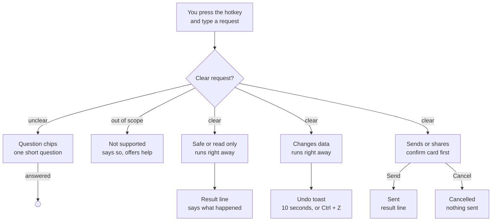

# Local Assistant Engine — 09 UX Flows

6 Nov 2026 · @Ved Narvekar

## Summary

The engine can be fast and smart, but users judge it by what they see. A confusing confirm or a hard sign-in loses them in seconds. This doc defines every screen and flow before any UI code is written.

It covers the screens, the core request flow, onboarding, app connections, confirms, questions, Undo, chained requests, errors, privacy controls and keyboard shortcuts.

## UX principles

1. One hotkey, one box. Everything starts from the command bar.
2. Faster than doing it by hand. If a task takes longer through the assistant, it has failed.
3. Never surprise the user. Anything that reaches another person is shown first.
4. Every change can be undone. Undo is always one click or keystroke away.
5. Ask, don’t guess. When unsure, ask one short question with choices.
6. Say what happened. One clear line after every task, in plain words.
7. Keyboard first, mouse friendly. Every action works with keys alone.
8. Ask for access only when needed. No long setup. Apps connect the first time a task needs them.
9. Stay out of the way. The bar closes itself when the job is done.

## Screens

| Screen | What it is | When it appears |
|---|---|---|
| Command bar | A single text box, centered near the top of the screen | When the user presses the hotkey |
| Result line | One short line under the box, like “Playing Arijit Singh on Spotify” | After every finished task |
| Confirm card | Shows who, what and where, with Send and Cancel | Before any send or share |
| Question chips | One short question with 2–3 tappable answers | When the request is unclear |
| Undo toast | Small bar with an Undo button | For 10 seconds after a change |
| Progress list | Steps of a chained request, ticked off one by one | During chained requests |
| Connect card | “Connect Gmail to do this,” with a Connect button | The first time a task needs an app |
| Notification | Standard Windows notification | Reminders, timers, finished background tasks |
| Tray icon | Small icon in the Windows taskbar tray | Always; opens settings and pauses the assistant |
| Settings | Hotkey, connected apps, privacy controls | From the tray icon or by typing “settings” |

## Core request flow

**Every request ends in a result, an Undo, or a confirm**

The risk level from 02 Scope decides what the user sees. Only sends and shares stop for a confirm, so everyday tasks stay instant.

## Flow: first-run onboarding

Goal: the user completes a real task within 60 seconds of installing. No app sign-ins are required up front.
1. Welcome. One screen: “Your helper runs on this laptop. Nothing you ask leaves your device.” Button: Get started.
2. Pick a hotkey. A default is shown, with a Change option. The user presses it once to try.
3. First win. The bar opens with a suggested request already typed: “Open Notepad.” The user presses Enter and sees it work.
4. Show three examples. Short cards: “Play music on Spotify,” “Set a reminder,” “Find a file.” Each can be tried with one click.
5. Done. “Press your hotkey anytime.” The bar hides. Apps connect later, only when a task needs them.

Skipped on purpose: account creation, a list of every feature, and asking to connect all apps at once.

## Flow: connecting an app

Apps connect just in time, inside the task that needs them. The user never leaves the task halfway.
1. The user asks “Any urgent emails?” before Gmail is connected.
2. A connect card appears: “Connect Gmail to check your email. Only this laptop gets access.” Buttons: Connect, Not now.
3. Connect opens the official Google sign-in page in the browser.
4. After sign-in, the browser says “You can close this tab.” The command bar comes back on its own.
5. The original request runs automatically. The user sees their urgent emails.

For WhatsApp, which has no sign-in, the card instead says: “Open WhatsApp on this laptop and sign in once.” The assistant checks it’s ready, then continues. If the user picks Not now, the bar says “OK. Ask again anytime,” and does nothing else.

## Flow: confirm before sending

The confirm card must be readable in under 2 seconds. It answers three questions: who, what and where. Example for “Send this file to Ved on WhatsApp”:
- Who: Ved, with photo and the last 4 digits of the number
- What: Q3_report.pdf, 2.4MB, with a small file icon
- Where: WhatsApp

Buttons: Send (Enter), Edit (Tab), Cancel (Esc)

Rules:
1. Send is never pre-pressed or automatic.
2. Message text is shown in full, exactly as it will be sent.
3. Edit lets the user change the recipient, file or text in place.
4. Cancel sends nothing and says “Cancelled. Nothing was sent.”
5. After sending, the result line says “Sent to Ved on WhatsApp.”

## Flow: asking one question

When two or more answers fit, the assistant asks one short question and waits. It does nothing until the user answers. Example for “Send this to Rahul” with two contacts named Rahul:
1. Question: “Which Rahul?”
2. Chips: Rahul Mehta (usually on WhatsApp), Rahul Shah (work email), Someone else
3. The user taps a chip or presses 1, 2 or 3.
4. The task continues to the confirm card.

Rules:
- At most one question per request. If more is unclear, ask for the most important part only. Each chip shows a short hint, so the right choice is obvious.
- “Someone else” always appears, so the user is never stuck.
- The answer is remembered as a default for next time.

## Flow: Undo

Changes run right away, so they feel fast. Undo makes that safe.
1. The user asks “Move these PDFs to the invoices folder.”
2. The files move. The result line says “Moved 4 PDFs to invoices.”
3. An Undo toast shows for 10 seconds. Ctrl + Z also works while it shows.
4. If Undo is pressed, the files go back and the line says “Undone. Files are back where they were.”

After the toast closes, the user can still undo from the action log in settings, as long as the change can be reversed. Sent messages and emails can’t be undone, which is why they get a confirm instead.

## Flow: chained requests

The user sees the plan before it runs, and each step ticks off as it finishes. Example for “Find the budget sheet and send it to Rahul on WhatsApp”:
1. The bar shows the plan as a short list: “1. Find the budget sheet 2. Send it to Rahul on WhatsApp.”
2. Step 1 runs and ticks off: “Found Budget_Q3.xlsx.”
3. Step 2 needs a send, so the confirm card appears with the found file.
4. After Send, step 2 ticks off. The bar shows “Done. 2 of 2 steps.”

If a step fails, the chain stops there. The bar shows which steps finished and what failed, like “Found the file, but WhatsApp isn’t open.” It offers a fix, like Open WhatsApp and retry.

## Flow: errors and out-of-scope requests

Every error message has two parts: what happened, and what the user can do next. No error codes or technical words.
| Situation | Message | Button |
|---|---|---|
| Request not supported yet | “I can’t book rides yet. I can open the Uber website for you.” | Open website |
| App not signed in | “Gmail needs you to sign in again.” | Sign in |
| No internet | “Weather needs internet. Everything else still works offline.” | Retry |
| App changed and a step broke | “I opened Ved’s chat. Press Send to finish.” | None needed |
| Not sure what was meant | “I didn’t get that. Did you mean…” with 2–3 chips | Chips |
| Something went wrong inside | “Something went wrong. Trying once more.” Then, if it fails again: “That didn’t work. Nothing was changed.” | Report problem |

The assistant never pretends a task worked. If it isn’t sure, it says so.

## Flow: memory and privacy controls

Users must always be able to see and control what the assistant knows. These live in Settings, under Privacy.
- What I’ve learned: a plain list, like “‘Ved’ means Ved on WhatsApp” or “‘the report’ means files in /Reports.” Each line can be edited or deleted.
- Action log: every request and what happened, newest first. Searchable. Can be cleared.
- Connected apps: each app with a Disconnect button.
- Pause learning: stops saving new defaults. Existing ones still work.
- Delete everything: one button, with a confirm, that wipes all local data.

The user can also ask in the bar: “What do you know about me?” or “Forget Ved.”

## Keyboard shortcuts

| Key | Action |
|---|---|
| Hotkey (default to be chosen) | Open or close the command bar |
| Enter | Run the request, or press Send on a confirm |
| Esc | Cancel and close |
| Tab | Edit on a confirm card |
| 1, 2, 3 | Pick a question chip |
| Ctrl + Z | Undo, while the Undo toast shows |
| Up arrow | Bring back the last request |

## Open decisions
