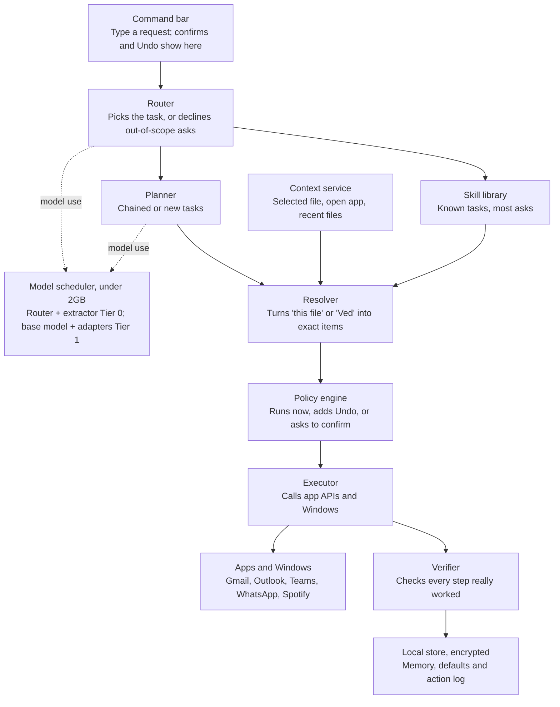
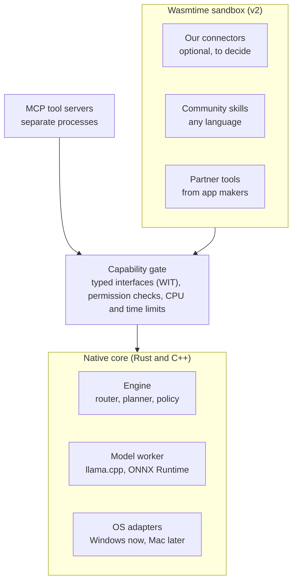

# Local Assistant Engine — 06 High-Level Design

**6 Nov 2026** · **@Ved Narvekar**

## Summary

The engine is a light desktop app that runs every request on the laptop, using small models plus plain code. This is a first draft. It gets revised once the spikes in 05 return real numbers.

## Design principles

1. **Code does most of the work.** Models only answer narrow questions, like “which task?” or “which contact?”
2. **Known tasks skip the big model.** Ready-made skills cover most requests.
3. **Load models only when needed.** Two small always-on models (router encoder, extractor); the big model loads only for new chains.
4. **Official APIs first.** The accessibility tree is the fallback. No screenshots in V1.
5. **Check every step.** Code confirms each action actually worked.
6. **Safety by risk level.** Anything that sends or shares needs a confirm.

## Architecture

*Known tasks skip the big model, and everything runs on the laptop.*

Most requests flow straight down the left side. The skill library handles known tasks, so the 1–3B base model loads only for chained or new ones.

## Plugin host (v2, designed now)

The product must scale from 49 skills to thousands (see the guiding principle in [00 Full Product Map](../00-vision/00%20Full%20Product%20Map%20%28End%20Goal%29.md)). From v2, plugins run sandboxed, and only the capability gate talks to the core.

The core, models and OS adapters stay native for speed. Every plugin, whether a WASM skill or an MCP tool, reaches them only through the capability gate, which checks permissions and limits on every call. Rules: [07 LLD, Capabilities](7%20-%20Low-Level%20Design.md). Which WASM ideas we use: [6.1 Tech Stack, plugin sandbox](6.1%20-%20Tech%20Stack.md). Developer-facing side: [00.11](../00-vision/00.11%20Developer%20Platform.md).

## Components

| Component | What it does | Tech | Memory |
|---|---|---|---|
| Command bar | Takes typed requests, shows confirms, results and Undo | Tauri (uses the OS web view) | ~40MB (likely higher because of the web view; measure in SP8 and SP11) |
| Core engine | Runs the whole flow and the background service | Rust | ~30MB |
| Router | Picks the task, or “out of scope” | Small encoder + classifier head (ONNX Runtime, int8) | ~100MB |
| Extractor | Pulls out names, files, times, places | GLiNER-small int8 (ONNX) + rules + runtime gazetteers | ~200-700MB, to re-measure |
| Resolver | Turns “this file” or “Ved” into the exact item | Rust code + context service + memory | Small |
| Skill library | Ready-made workflows for the 49 tasks | Declarative skill files (YAML) | Small |
| Planner | Builds plans for chained or new requests | 1–3B model, 4-bit, with adapters (llama.cpp) | ~1–1.8GB, on demand |
| Policy engine | Applies risk levels, confirms and blocks | Rust code | Small |
| Executor | Calls apps and the OS | Connectors: Google APIs, Microsoft Graph, Windows APIs, UI Automation | Small |
| Verifier | Checks each step really worked | Rust code, per-skill checks | Small |
| Context service | Knows the selected file, open app and recent files | Windows UI Automation + file system | Small |
| Model scheduler | Loads and unloads models within the 2GB budget | Rust, memory-mapped model files | Small |
| Local store | Memory, settings, action log, reminders | SQLite with encryption (SQLCipher) | Small |

Idle total stays near 250MB, under the 300MB target. Peak stays under 2GB when the planner loads.

## Request flow

Every request follows the same eight steps. Known tasks never load the planner.

1. **Capture.** The user types in the command bar. The context service attaches the selected file and open app.
2. **Route.** The router picks a task with a confidence score. Out-of-scope requests are declined here.
3. **Plan.** A known task loads its skill template. A chained or low-confidence request loads the planner, which sees only the 3–5 most relevant skills.
4. **Resolve.** The extractor pulls out names, files and times. The resolver matches them to exact items. If two match, the engine asks one question.
5. **Policy check.** The risk level decides: run now, run with Undo, or confirm first.
6. **Execute.** The connector calls the app or the OS.
7. **Verify.** Code checks the result. On failure it retries once, then explains what went wrong.
8. **Report and learn.** One-line result, Undo if needed, an entry in the action log, and updated defaults.

## Model layout

Two tiers. Tier 0 is always loaded and handles most requests. Tier 1 loads only when needed.

| Tier | Model | Jobs | When loaded | Size |
|---:|---|---|---|---|
| 0 | Router encoder (~25M) + GLiNER-small extractor (~170M) | Routing, skill retrieval, extraction | Always | ~300-800MB, SP8 to confirm |
| 1 | One 1–3B base model, 4-bit | Planner, summaries, reply drafts | On demand, unloaded after idle time | ~1–1.8GB |
| 1 adapters | Adapters on the base model (~10–50MB each) | One per job: planner, summarizer, reply writer | Swapped in with the job | Small |

All models are trained offline. A large teacher model creates training data. Only the small students ship. Exact model choices come from spikes SP1–SP4.

## Data storage

Everything lives on the laptop. Nothing personal goes to the update server.

| Data | Where | Protection |
|---|---|---|
| Learned defaults (usual contact, app, folder) | Local store | Encrypted; user can view, edit, delete |
| Action log | Local store | Encrypted; user can view and clear |
| Reminders and timers | Local store | Encrypted |
| App sign-in tokens | Windows Credential Manager | Managed by the OS; never in plain text |
| Models and skills | App folder | Signed; checked before loading |
| Settings | Local store | Encrypted |

## Security design

- **Content is never a command.** Email bodies, messages, files and web pages go into the models as marked data. Only the user's own request can start an action. (SR5)
- **The policy engine is plain code.** No model can skip a confirm or a block. (SR4, SR6)
- **Models run in a separate process.** A model crash or memory spike can't take down the engine.
- **Least access.** Each connector asks only for the app permissions its tasks need.
- **Signed updates.** Models and skills are signed. Unsigned files are refused.
- **Web lookups are scrubbed.** Only search terms leave the device, never names or file contents. (PS3)

## Cross-platform approach

The code splits into two layers, so Mac support later means a new adapter, not a rewrite.

- **Shared core (about 80% of the code):** router, planner, skills, policy, verifier, scheduler, store, and the cloud app connectors (Google, Microsoft). This works the same on Windows and Mac.
- **OS adapter (about 20%):** UI Automation, file search, system controls, notifications and the keychain. Windows gets one adapter in V1. Mac gets its own later, using macOS Accessibility and Spotlight.

The split percentages are rough estimates, to be confirmed in the LLD. Keep the OS adapter boundary clean, but write no Mac code until v2.

## Update server

V1 needs only a small backend. It never receives requests, files or personal data.

- **Model and skill updates:** signed packages the app downloads. Adapters ship as small files, so most updates are a few MB.
- **App updates:** the installer and new versions.
- **Licensing:** checks a free or paid plan, using an account ID only.
- **Crash reports:** opt-in, with personal data stripped.

Federated learning and a team admin console come in later versions.

## Open decisions

- [ ] Revise this draft with the spike results from 05.
- [ ] Pick the exact encoder and 1–3B base model (SP1–SP4).
- [ ] Confirm Tauri works well with the command bar and hotkey on Windows.
- [ ] Choose where the update server is hosted.

*Merged from: 00.A Addendum, items A1 (plugin host) and A6/A7 (Mac code timing, command bar memory).*

**Next doc:** [07 Low-Level Design (LLD)](7%20-%20Low-Level%20Design.md). Detailed design per component: skill file format, connector interfaces, scheduler logic, database tables and error handling.

## Resource and cloud rules (decided 8 Nov 2026, with evidence)

Goal: never slow down a developer's machine with many windows open. Measured numbers are `[M]` (this PC, spikes/sp8-pipeline, `footprint.py` and `throttle.py`, not yet the 8GB laptop). Confirmed Microsoft or vendor facts are `[V]`. Everything else is a design choice.

**Three processes, each started only when needed**

| Process | Resident cost | Rule |
|---|---|---|
| Core (Rust: router call, policy, skills, store) | 14 MB working set, 2 MB private `[M]` | Always on. No polling. |
| UI shell (Tauri bar) | about 160 MB private while open `[M]` | Destroy the web view when idle (about 60 s). Reopen cost about 1 s `[M]`. |
| Model worker | router about 85 MB, extractor about 240 MB after load, peak about 365 MB during load `[M]` (Python harness; Rust will be lower) | Separate process, started on demand, exits after idle. Memory only returns reliably on process exit: unloading a session in-process freed nothing `[M]`. Load takes about 0.1 s (router) and 0.85 s (extractor) `[M]`. |

**Worker is a polite background process.** Set on start: EcoQoS (`ProcessPowerThrottling`), idle or below-normal priority, memory priority very low, 1 thread, spin-wait off, and a Job Object commit cap so it cannot balloon `[V]` (all documented, no admin needed; the job cap limits committed memory, not RSS). Test: with all 8 cores saturated by a competing job, a worker running flat out cost it 7 to 19 percent at normal to idle priority, and 7 percent at idle plus EcoQoS, against a 7 percent noise floor between baseline runs `[M]`. A real user sends a request every few seconds, not flat out, so the practical cost is near zero. The earlier test is a worst case.

**Local first, cloud only when necessary**
1. Common tasks run fully on the device (rules, gazetteers, router, templates). No network.
2. Cloud is used for (a) integrations that are cloud by nature (Microsoft 365, Google), and (b) optional "assist" when local confidence is low and policy allows: hard extraction, planning, summaries. It is off in local-only mode.
3. Anything sent is scrubbed on the device first (no file contents, no attachments). Anthropic offers no server-side redaction, only region controls `[V]`, so scrubbing is our job.
4. Data handling `[V]`: API inputs and outputs are deleted within 30 days (longer only for policy flags or legal need), are not used for training by default, and zero data retention is available by contract. A DPA with SCCs is part of the commercial terms.

**Web view memory.** Prefer destroy-when-idle. WebView2 also offers `MemoryUsageTargetLevel=Low` and `TrySuspend` `[V]`, reachable in Tauri only through the platform controller, not a first-class API.

**Shipping.** Unsigned apps hit SmartScreen and Smart App Control on every new version `[V]`; an EV certificate no longer bypasses SmartScreen `[V]`. Azure Artifact Signing is not available to organisations in India `[V]`. Routes to price: an OV certificate from a commercial CA, a US entity, or Microsoft Store distribution.

**What is still unproven (test before relying on it):** the numbers on the 8GB laptop; Rust (not Python) footprint; the extractor's accuracy gap (SP2) with cloud assist.
